# Hyper Workspace

[](https://github.com/MkaliezZ/hyper-workspace/actions/workflows/ci.yml)

面向企业内部的 AI 协作 IM：讨论有沉淀，行动有回执，成果能修改，经验能复用。蓝、白、黑配色；拥有自己的业务核心与企业资产服务。

**开发进行中，尚未达到生产可用状态。** 当前提供真实 PostgreSQL 持久化的协作链路、模型配置与 pgvector 检索。DSH/Hermes 两个原生运行时及往返切换已通过本地测试模型链路；Nextcloud 企业身份、Talk 通信、来源关联项目、AI 个人回复草稿、Files 个人文本导入与个人 AI 解读已通过固定版本真实服务 CI（使用独立测试账号、本地模型协议服务）。已用真实 DeepSeek Flash 在本机完成 DSH 纪要/两条待办和 Hermes 同一成果续改的小样例，[结果与边界](docs/REAL-MODEL-SMOKE.md)。更多真实模型质量、完整组织/通知/管理、跨连接预算和公司部署验收仍待完成；Calendar 与复杂办公/媒体按基线后续阶段补齐。

## 实际界面

下图为本地运行截图，使用明确标记的演示资料和真实 PostgreSQL 持久化。演示执行不调用真实模型。

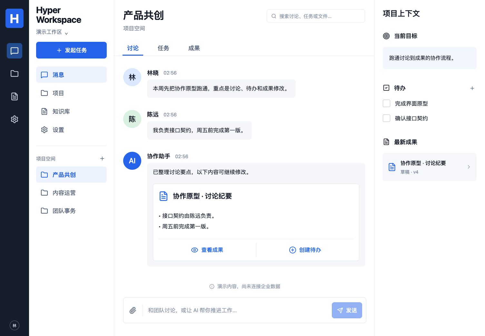

[查看移动端截图](docs/images/workspace-mobile.png) · [设计参考与核对记录](docs/design/DESIGN.md)

导航、项目及标签切换采用约 180ms 淡入和轻微上移；不会因后台刷新反复播放，开启系统“减少动态效果”时关闭。

## 技术架构

- React + TypeScript + Vite：聊天、项目上下文、任务、成果和设置。
- NestJS 模块化业务核心 + 独立执行 Worker。
- PostgreSQL + pgvector：业务状态、资产目录、关系和语义索引。
- pg-boss：后台分发；业务动作另做幂等、回执和对账。
- DSH 默认执行器、Hermes 兼容执行器，统一 EngineAdapter。
- Nextcloud 通过身份、通信、文件和日历 Provider 接入。

企业资料与产品状态独立于执行器；引擎切换保持业务接口稳定，不承诺私有检查点热迁移。

人工添加与 AI 生成待办共用产品业务服务；人工/AI 修改单条待办也共用带版本校验的服务，可改标题、负责人文字标记、日期和状态，保留历史并支持人工接管。创建时的负责人文字仍是标记；可从“修改待办 → 按真实员工身份分配”明确选择当前项目成员，人工或 AI 绑定员工 ID，改派与历史均保留。状态变更不代表实际工作验收。[待办修改与版本契约](docs/TASK-REVISIONS.md)。实现 `9376aa9` 的 [CI](https://github.com/MkaliezZ/hyper-workspace/actions/runs/40974156265) 三个 job 成功，165 项首轮通过，包含双执行器、真实 Nextcloud 权限、界面和容器重启；使用合成测试资料与协议模型。

## 方法与模板

“知识库 → 方法与模板”支持从已保存成果整理 SOP、模板、案例、量规和术语。人工与 AI 共用服务：先保存候选，由员工确认验证依据后发布；支持版本修订、撤回，以及在纪要、周报和成果修改中复用确切版本。AI 不能自行验证、发布为公司规则或改变员工确认的操作。工作区级发布需要管理员；企业会话来源的方法仍限来源项目。

最终实现 `3015eaa` 的 [完整 CI](https://github.com/MkaliezZ/hyper-workspace/actions/runs/41001696525) 三个 job 成功、178 项首轮通过，含 37 界面、双执行器、真实来源权限与受限容器重启/撤回；输入隔离和失权后的迟到响应清理也已覆盖；没有真实模型或公司验收结论。[方法资产、权限、回执与迁移](docs/METHODS.md) · [实际桌面界面](docs/images/methods-desktop.png) · [手机界面](docs/images/methods-mobile.png)。

## 执行规则

“设置 → 执行规则”支持工作区、项目和个人限制；发起任务时可以进一步收紧单次限制。允许执行器/工作类型取交集，支持上下文字节、输出 token、时间、业务动作和每日执行次数上限。人工保存与 AI 按已确认方案代保存共用服务，保留版本、回执和运行快照；模型不能自行改权限。

每日次数是获准执行的 Run 数，尚不是供应商调用数、token 用量或费用账单。[规则契约、额度口径与迁移](docs/EXECUTION-POLICY.md) · [桌面界面](docs/images/execution-policy-desktop.png) · [手机界面](docs/images/execution-policy-mobile.png)。执行规则实现 `8463fb1` 的 [CI](https://github.com/MkaliezZ/hyper-workspace/actions/runs/41029145378) 三个 job 全部成功、188 项首轮通过（含 104 数据库、38 UI、双引擎、真实来源和容器）。

## 模型用量

“设置 → 模型用量”记录本人实际发起的模型 HTTP 请求和供应商返回的输入/输出 token，包含两套执行器、连接验证及向量请求。完整、部分、未知和无效统计分别展示；AI 可回读同一份个人记录，模型不能选择其他员工或虚构费用。执行器只取得短期网关凭据，真实供应商 Key 留在产品后端。

实际 DeepSeek Flash 的 DSH/Hermes 两次合成回读已成功，均记录到供应商用量；金额估算和员工声明与供应商账单分开。[用量口径、权限与迁移](docs/MODEL-USAGE.md) · [桌面界面](docs/images/model-usage-desktop.png) · [手机界面](docs/images/model-usage-mobile.png)。

“设置 → 价格与预算”支持人工价格版本、按连接的 UTC 每日预算、请求预留和明确金额核对，人工/AI 共用服务。预算不足、未知费用或超预留会阻止后续请求；已发请求仍可能超额，不承诺供应商账单硬封顶。组织/项目跨连接预算和自动账单对账仍待实现。[契约与回退](docs/MODEL-SPENDING.md) · [桌面](docs/images/model-spending-desktop.png) · [手机](docs/images/model-spending-mobile.png)。

最终代码 `22757e44b30dd4ca480e4f458f74e8dfd44f1bec` 的 [CI 41040063081](https://github.com/MkaliezZ/hyper-workspace/actions/runs/41040063081) 三个 job 全部成功，210 项首轮通过：25 单元/配置、3 下载器、8 解析、118 数据库、3 原生执行器、40 UI、9 真实来源、4 容器；另含类型、构建、两个 npm 审计与冻结包。模型、单价、金额声明和企业资料均为明确合成样例，不代表供应商账单或公司上线验收。

## 项目成员与员工分配

任务页可查看、筛选当前项目成员；来源 UID 与产品员工精确对应，同名不自动匹配，尚无当前工作区身份/权限的人不可分配，不自动建号或授权。人工与 AI 共用目录及分配服务；绑定员工后不能通过旧文字标记改选身份，同名人员之间的改派也能被跟进识别。

[范围、权限、迁移与实际证据](docs/PROJECT-DIRECTORY-ASSIGNMENTS.md) · [桌面](docs/images/task-assignment-desktop.png) · [手机](docs/images/task-assignment-mobile.png)。当前是项目范围目录和明确身份分配，完整组织通讯录、部门树与讨论中自动消歧仍待补齐。

目录分配实现 `7de26bb353dc2c267644784e38f673bd13322ac0` 的 [CI 41075340989](https://github.com/MkaliezZ/hyper-workspace/actions/runs/41075340989) 三个 job 全部成功，227 项首轮通过：25 单元/配置、3 下载器、8 解析、132 数据库、4 原生执行器、42 UI、9 真实来源、4 容器；另含类型、构建、两个 npm 审计与冻结包。CI 使用合成账号/资料和协议模型，不等于公司全量验收。 实际 DeepSeek Flash 的目录回读与明确员工 ID 分配两个合成小样例通过，[实际模型记录](docs/REAL-MODEL-SMOKE.md)。

## 企业消息附件

企业会话支持接收附件卡片、当前来源查看及 8 MiB 内受限下载。打开/下载时重新检查会话、确切消息/文件、版本与当前权限；隐藏下载、删除或撤权后拒绝读取，HTML 等按二进制附件下载。AI 上下文只取得明确标记的附件引用，不凭文件名宣称读取正文。

[协议、权限与验证边界](docs/MESSAGE-ATTACHMENTS.md) · [桌面](docs/images/message-attachments-desktop.png) · [手机](docs/images/message-attachments-mobile.png)。本地 139 数据库、25 单元、类型/构建、冻结包和完整 43 UI 重跑已通过。

修正实现 `0449f94a0ddd9ac0c8be146bf2bd6ff43ca074a4` 的 [CI 41083527775](https://github.com/MkaliezZ/hyper-workspace/actions/runs/41083527775) 三个 job 全部成功，共 236 项首轮通过：25 单元/配置、3 下载器、8 解析、139 数据库、4 原生执行器、43 UI、10 真实来源、4 容器；另含类型、构建、两个 npm 审计与冻结包。真实 Nextcloud 合成账号验证附件接收、发送者/接收者二进制下载与安全响应头、浏览器下载、移除成员和原件删除后的拒绝读取；不等于真实公司资料验收。

从当前员工的 Files 选择已有文件，可直接发送或交给 DSH/Hermes 执行；房间、文件版本和说明由员工确认，按实际源消息回读记录结果，未知投递仅核对、不自动重发。修正实现 `a6f1b8422eed649c164e59a6569441ca22e21a1c` 的 [CI 41120571893](https://github.com/MkaliezZ/hyper-workspace/actions/runs/41120571893) 三个 job 全部成功，共 246 项通过：25 单元/配置、3 下载器、8 解析、147 数据库、4 原生执行器、45 UI、10 真实来源、4 容器；另含类型、构建、两个 npm 审计与冻结包。真实 Nextcloud 合成账号已验证人工/幂等与重复分享、DSH/Hermes 投递、双方下载和撤权；模型为协议测试服务，不代表该工作流的真实供应商质量或公司验收。[发送与恢复契约](docs/ATTACHMENT-SENDING.md) · [桌面](docs/images/attachment-send-desktop.png) · [手机](docs/images/attachment-send-mobile.png)。

新增本机附件上传入口：先明确确认保存至当前员工 Files，核对原始字节后选中，再人工或交给 DSH/Hermes 分享；不自动把字节交给模型。持久上传意图、条件创建、未知核对和大小限制已接通，本地 155 数据库/HTTP、25 单元、完整 47 UI、类型/构建和冻结包通过，上传实现 `73fced090dc36a00996f701fcca0be76715b1ff9` 的 [CI 41124972265](https://github.com/MkaliezZ/hyper-workspace/actions/runs/41124972265) 三个 job 全部成功，共 256 项首轮通过，包含真实 Nextcloud 合成账号上传/双引擎分享及容器验证；不代表真实供应商质量或公司验收。[上传与恢复契约](docs/ATTACHMENT-UPLOADS.md) · [桌面](docs/images/attachment-upload-desktop.png) · [手机](docs/images/attachment-upload-mobile.png)。整体尚未交付。

## 当前整批开发状态

独立项目决定、工作计划/自然语言消歧、长文分块/多资料私人问答、方法维护人移交正在同一批次整合。已有人工/AI 业务入口、本地权限/版本/源变化测试与界面；尚未完成本批次原生 SDK、真实来源/容器及真实供应商验收，不据此宣称整体交付。[决定](docs/DECISIONS.md) · [工作计划与澄清](docs/WORK-PLANS.md) · [多资料问答与索引](docs/KNOWLEDGE-CONTEXT.md) · [方法](docs/METHODS.md)。

本地整批回归已通过：29 单元/配置、182 数据库/HTTP、5 原生执行器、56 Chromium UI、8 文档解析、3 下载回归，以及类型/构建/冻结包。首次 UI 55 过/1 个 fixture 会话失败，修正后原场景及完整 56 项重跑通过，无重试。审计补充另复测 8 个工作计划数据库场景及原生联合场景；新增真实 Nextcloud/容器覆盖随本批提交核验，不把本地结果写成公司上线结论。

已修复当前页面的空响应 JSON 异常：失败保留草稿，写操作先核对原回执；Run 轮询恢复后自动清除临时错误。[恢复契约与本地证据](docs/API-RECOVERY.md)。

项目“工作计划”已接通：AI 整理步骤，服务端固定人员 ID 和目标版本；同名、旧版本与缺失信息由员工澄清，可人工接管或明确让 AI 据答案续改，最后确认才保存实际任务/成果。当前本地 8 个数据库、2 个桌面/手机场景通过，联合真实 DSH/Hermes 的整批用例通过；模型为本地协议服务。来源/容器及真实供应商质量仍需本批次核验。

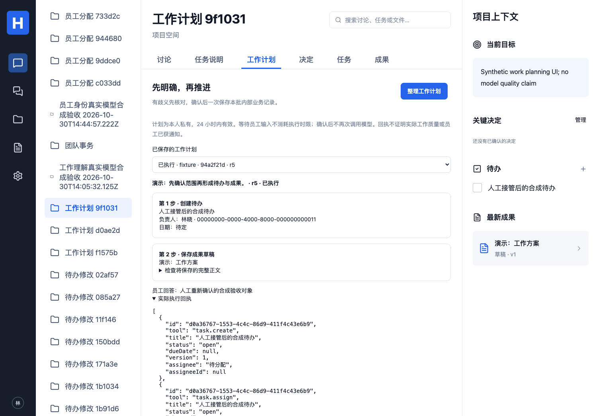

## 任务说明与澄清

项目“任务说明”页可人工或通过 AI 整理目标、范围、约束和完成标准，提出必要问题。员工回答并确认当前版本后，可绑定版本发起纪要、周报或成果修改；说明被改动或重新打开时，旧引用不能继续产生业务动作。DSH/Hermes 共用说明、答案与回执，不依赖私有检查点。

[说明、权限、迁移与边界](docs/WORK-BRIEFS.md) · [桌面](docs/images/work-brief-desktop.png) · [手机](docs/images/work-brief-mobile.png)。当前为说明入口的明确澄清闭环，通用自然语言歧义路由和完整业务验收仍待完成。

说明实现 `5daf7e67ea44c16abb3c32344d2fde01c10e3a18` 的 [CI 41043632497](https://github.com/MkaliezZ/hyper-workspace/actions/runs/41043632497) 三个 job 全部成功，218 项首轮通过：25 单元/配置、3 下载器、8 解析、124 数据库、4 原生执行器、41 UI、9 真实来源、4 容器；另含类型、构建、两个 npm 审计与冻结包。CI 使用合成资料和协议模型，不能代替公司验收。 实际 DeepSeek Flash 的 DSH 澄清 → 合成回答/确认 → Hermes 绑定成果小样例通过，[实际模型证据](docs/REAL-MODEL-SMOKE.md)。

## 本地开发

需要 Node.js 24 与可用的 PostgreSQL（安装 pgvector）。容器运行包见下方自部署章节。

```bash
npm ci
cp .env.example .env
```

在本地 .env 中配置 DATABASE_URL、APP_ORIGIN 与 CREDENTIAL_MASTER_KEY。加密主密钥通过下面的命令生成，不要提交到 Git：

```bash
node -e "console.log(require('node:crypto').randomBytes(32).toString('hex'))"
npm run migrate
```

本机体验演示需显式设置 DEMO_MODE=true，然后运行：

```bash
npm run seed
npm run dev
```

打开 http://127.0.0.1:5173 ，点击“进入演示工作区”。演示登录仅接受本机请求；演示数据与确定性 fixture 执行不代表真实企业数据或模型效果。DSH/Hermes 未配置时会明确报错。

使用 DSH 时另行运行 `npm ci --prefix runtime/dsh`；Hermes 需要 Python 3.14.6，再运行 `python3 runtime/hermes/install.py`。在设置页保存 chat 模型连接，重启 API/Worker 后发起任务。可显式选择个人/工作区连接；自动选择时优先个人连接。[DSH](runtime/dsh/README.md) · [Hermes 安装及验证边界](runtime/hermes/README.md)。

## Docker Compose 自部署

新增构建后的网页/API、独立 Worker、PostgreSQL/pgvector 与一次性初始化服务；镜像包含锁定的 DSH/Hermes。Nextcloud 作为独立来源接入。配置生成器以 0600 创建新密钥文件并拒绝覆盖，容器持久化卷独立，默认只向主机 loopback 开放应用端口。

API/Worker 的数据库运行账号与管理员分离，管理员凭据仅用于数据库与初始化；[旧配置与旧数据卷升级说明](docs/DEPLOYMENT-DATABASE.md)。受限账号的业务、队列、容器权限与双执行器恢复已通过 CI，原有数据和加密主密钥保留。

```bash
node scripts/deploy-init.mjs
# 编辑 .env.compose 中的组织来源与 APP_ORIGIN
HYPER_REVISION=$(git rev-parse HEAD) docker compose --env-file .env.compose up -d --build
```

[完整配置、备份、迁移与回退说明](docs/DEPLOYMENT.md)。Linux amd64 容器构建、启动、双执行器、停启持久化与中断恢复用例已在 CI 通过；真实公司环境与生产验收仍待完成。

## 企业账号登录

已实现 Nextcloud Login Flow v2、明确群组准入和产品角色映射。需要单独初始化企业工作区，浏览器在 Nextcloud 页面完成授权。应用密码由后端加密保存，后台执行前重新检查来源权限。[配置、数据范围、撤权和验证边界](docs/NEXTCLOUD-IDENTITY.md)。

## 企业消息

“企业消息”通过当前员工身份读取和回复 Nextcloud Talk 会话；发送具有幂等回执与未知结果核对。群成员和原始消息仍由来源管理。点击“项目空间”可创建受限项目：成果、任务、检索与 AI 上下文均继承来源权限；任务可读取当前获准的最近至多 60 条普通消息，成果保存在项目，暂不自动发布到 Talk。[通信配置与恢复](docs/NEXTCLOUD-TALK.md) · [项目权限、数据范围与回退](docs/PROJECT-SOURCE-SCOPE.md)。

下图使用明确的 UI 协议测试资料，非真实公司消息；真实 Talk 链路由独立 CI 检查。

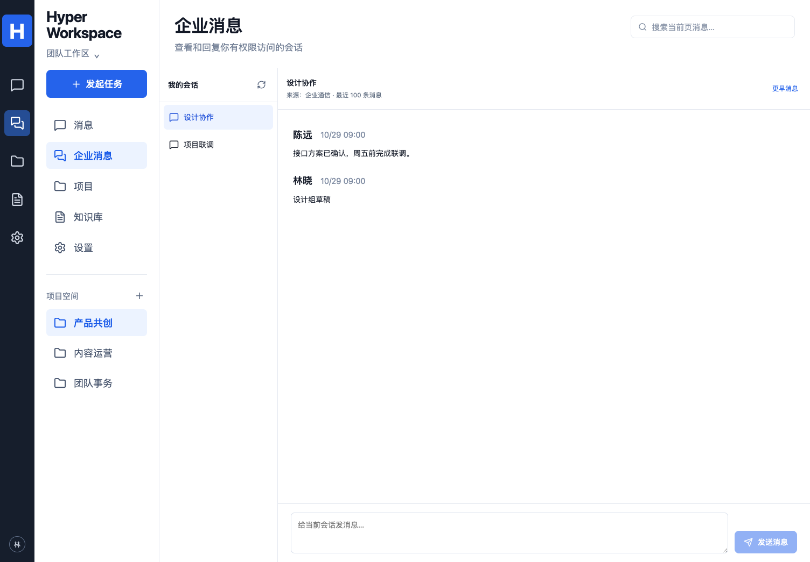

[移动端企业消息界面](docs/images/talk-mobile.png)

关联项目的权限提示如下，使用 UI 协议测试资料。原始消息留在来源，工作记录与成果保存在受限项目。

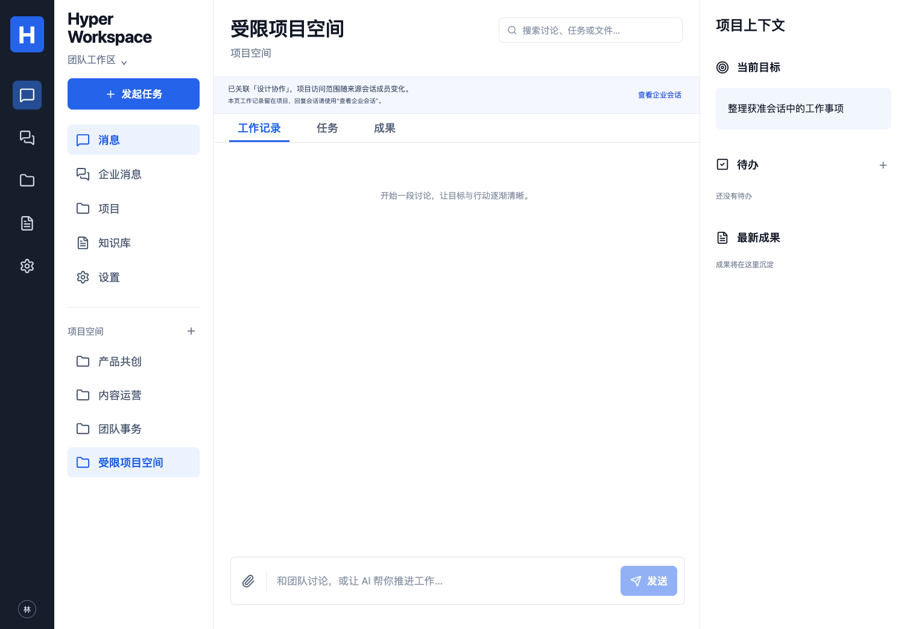

[移动端来源项目](docs/images/source-project-mobile.png)

新增“AI 起草回复”：选择模型生成个人草稿，检查、编辑后放入当前会话发送框，发送仍使用真实来源回执。草稿仅本人可见，不自动广播；已通过固定真实来源与双原生执行器的联合 CI。[完整契约与恢复边界](docs/AI-REPLY-DRAFTS.md)。

下图使用明确的 UI 协议测试资料，非公司消息或真实模型效果。

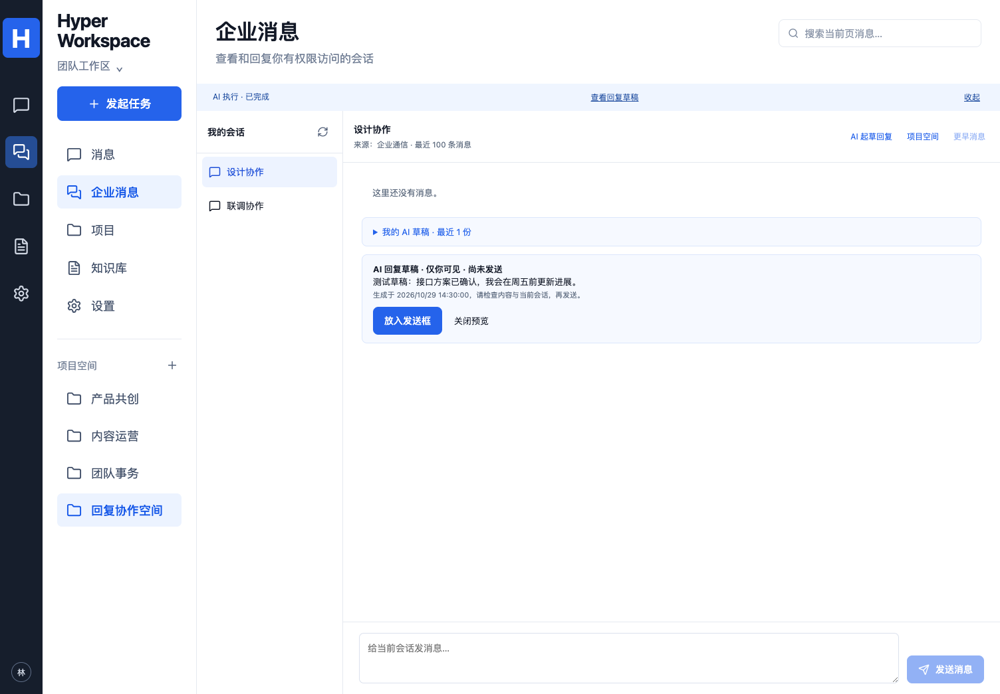

[移动端回复草稿](docs/images/reply-draft-mobile.png)

## 企业文件与个人资料

Nextcloud Files/WebDAV 支持浏览与显式导入，副本仅本人可见，可建立语义索引。读取、检索和索引重新检查来源；源更新、删除或撤权后停止使用旧正文和向量。文本/Markdown 与 PDF/DOCX/XLSX/PPTX 受控文本提取的真实来源/容器场景已通过 CI，成果保存界面竞态修复也已通过完整 CI。长文分块、共享发布和 Calendar 仍待完成。[文件契约](docs/NEXTCLOUD-FILES.md) · [文档提取、限额与部署](docs/DOCUMENT-INGESTION.md)。

下图使用明确 UI 协议测试资料，非真实公司文件。

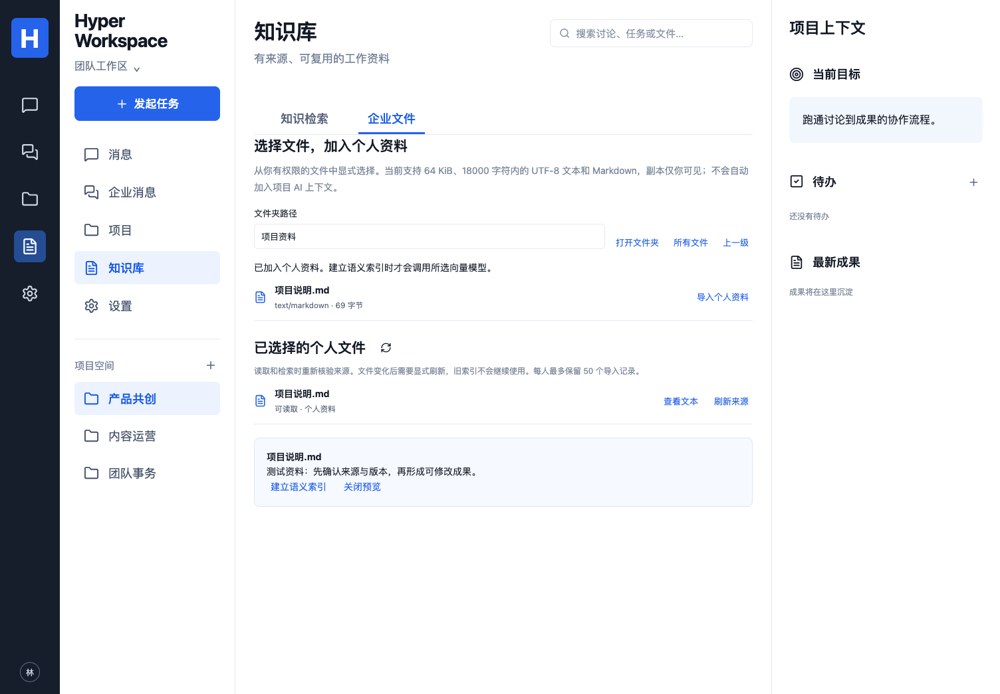

[移动端文件预览](docs/images/files-mobile.png)

新增个人“AI 阅读此文件”：选择 DSH/Hermes 与 chat 模型，基于所选当前版本生成个人解读，可人工修改并保留版本；源变更/撤权清理相关解读。该流程保持个人范围，完整共享发布与多文件 RAG 仍待实现。[范围、运行清理与迁移](docs/FILE-AI-READING.md)。

可对已保存的解读填写“AI 修改要求”，继续使用 DSH 或切换 Hermes，追加到同一解读的版本历史。AI 只使用当前文件与选中的已保存版本；人工已修改时拒绝旧结果，完成后保留编辑框草稿，由员工主动读取新版本。真实 Nextcloud 下的双向续改、源更新/撤权清理及容器回归已通过 CI；模型使用明确的协议测试服务。

下图为 UI 协议测试资料，非真实公司资料或模型质量证据。

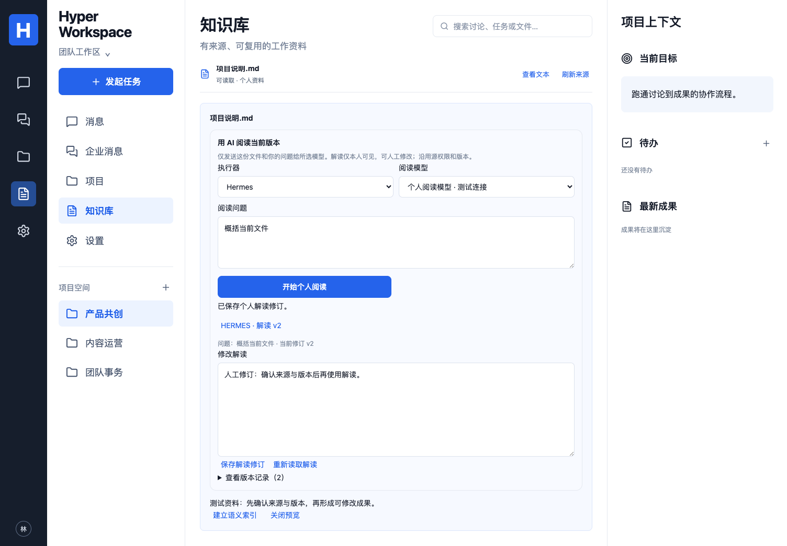

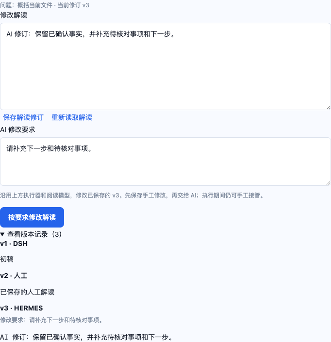

[移动端个人解读](docs/images/file-reading-mobile.png)

## 文本成果与验收

项目成果已支持纯文本/Markdown 编辑、AI 生成和反馈修订、历史版本。新增针对确切已保存版本的员工验收：接受、要求修改、重开，可直接记录或让 DSH/Hermes 代执行员工已确认的决定。新内容版本重新作为草稿，旧版意见保留；AI 不自行判断是否合格，也不自动把成果正文发送给模型。[验收契约、权限、迁移与证据](docs/ARTIFACT-REVIEWS.md)。

当前支持基础文本成果和个人文档提取阅读，尚无富文本、多人实时协作、批注评论或 Word/Excel/PPT 原件编辑。个人文件解读与项目成果分别保留权限范围。

“企业文件”新增 PDF/DOCX/XLSX/PPTX（最多 8 MiB、提取文本含位置最多 18000 字符），支持个人预览、AI 阅读/续改与索引。扫描件不执行 OCR；公式明确标记未计算，不承诺版式复现。解析器独立于 DSH/Hermes，安装方法、限制和证据见 [文档接入](docs/DOCUMENT-INGESTION.md)。修复 `1896d27` 的 [CI](https://github.com/MkaliezZ/hyper-workspace/actions/runs/40968561013) 来源 9 项与容器 4 项通过；主验证 UI 有 1 项重试后通过，已定位并修复保存后刷新竞态，修复提交 `9678126` 的 [CI](https://github.com/MkaliezZ/hyper-workspace/actions/runs/40971011531) 三个 job 成功、155 项首轮全部通过。首轮来源 401 及修复记录保留在文档中。独立组件 `5cdb970` 的 [CI](https://github.com/MkaliezZ/hyper-workspace/actions/runs/40966081563) 曾三个 job 成功、145 项通过，不能替代后续业务接入验证。

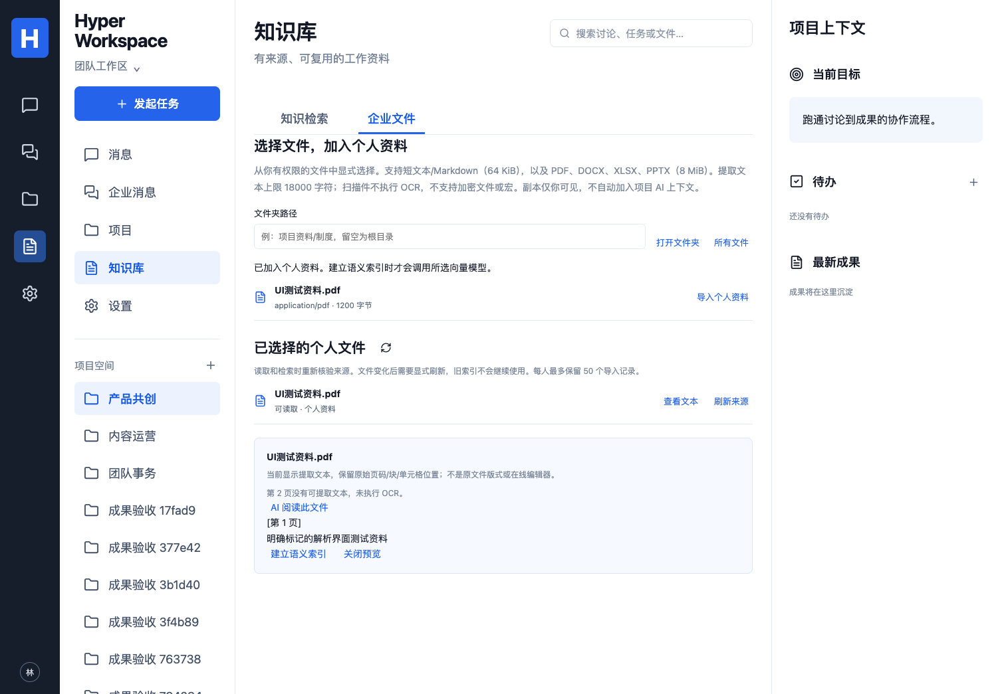

[移动端文档预览](docs/images/document-preview-mobile.png)

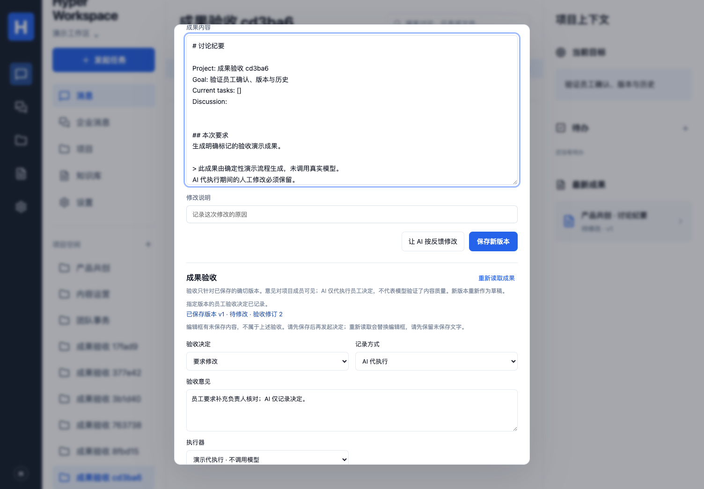

[移动端验收](docs/images/artifact-review-mobile.png)

## 待办跟进

“发起任务 → 检查待办进展”比较产品当前待办与项目共用基线。首次和无变化时只返回检查状态；变化合并为一条项目消息，保留前后字段、来源 Run 与实际消息回执。DSH/Hermes 及不同员工共用基线，模型不能自行决定通知或伪造完成。[单次检查、迁移、原子性、费用与证据](docs/FOLLOW-UP.md)。真实 Nextcloud 中的双引擎检查/撤权与容器回归已通过既有 CI，使用合成员工和确定性模型协议服务。

“任务 → 我的定时跟进”新增有限次数调度，可直接或经 AI 创建、暂停、恢复与取消。明确选择 15–1440 分钟间隔、1–96 次上限、执行器和固定模型，最晚 30 天停止；次数不是金额预算，每次检查仍可能产生模型费用。失败/失权暂停，重启不补跑错过的一串周期。[定时契约与证据](docs/FOLLOW-UP-SCHEDULES.md)。真实来源和容器完整 CI 已通过；组织级通知偏好、重要程度评分及跨连接总金额预算仍待实现；连接级金额闸门见上方“价格与预算”。

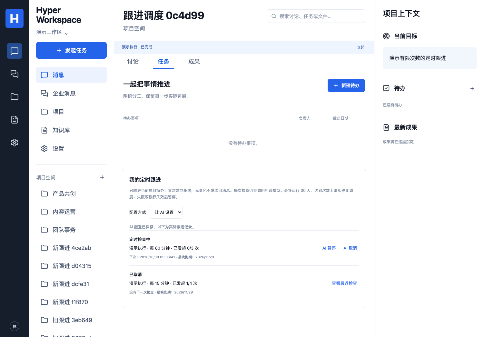

下图为明确的演示资料：上方显示本次检查静默，讨论区保留此前两项变化的一条消息。

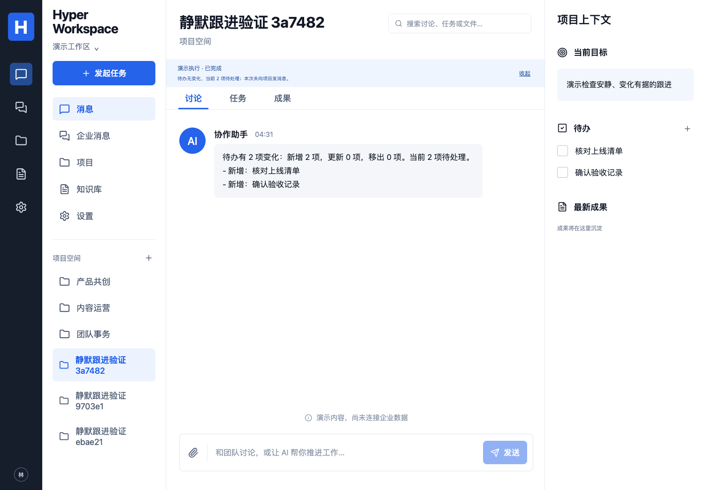

## 检查与验证

```bash
npm run typecheck
npm test
npm run build
# 仅使用隔离测试数据库，数据库名称必须以 _test 结尾
TEST_DATABASE_URL=postgres://用户:密码@127.0.0.1:5432/hyper_test npm run test:integration
npx playwright install chromium
npm run test:e2e
```

本地已通过 19 项单元/Provider/部署配置、80 项数据库、29 项浏览器、8 项 Python 文档解析，以及类型/构建。保存界面最后修订后 4 项成果 UI 复测通过；3 项双执行器原生运行时已有本机及前述 CI 证据。模型与向量 HTTP 测试使用明确的本地协议测试服务；不代表真实供应商效果。

成果验收实现 `e13b775` 的 [完整 CI](https://github.com/MkaliezZ/hyper-workspace/actions/runs/40964224588) 三个 job 全部成功，共 137 项测试：16 单元/Provider/配置、3 Python 下载回归、77 数据库、27 UI、3 原生执行器、8 真实来源、3 容器；另含类型、构建、两个 npm 审计和冻结包校验。验证双执行器记录员工确认的决定、真实来源权限、容器重启保留、历史版本状态及新版草稿。不代表真实模型质量、完整文档产品或 E01–E10/生产验收。

定时跟进与输入范围提示修正 `e73e025` 的 [完整 CI](https://github.com/MkaliezZ/hyper-workspace/actions/runs/40957686291) 三个 job 全部成功，共 127 项测试：16 单元/Provider/配置、3 Python 下载回归、70 数据库、24 UI、3 原生执行器、8 真实来源、3 容器；另含类型、构建、两个 npm 审计和冻结包校验。覆盖 DSH/Hermes AI 配置与派发、来源设备绑定/撤权、容器重启后配置/计数保留、恢复检查与次数耗尽。初始实现 `c9f8c28` 的 [首轮 CI](https://github.com/MkaliezZ/hyper-workspace/actions/runs/40956417646) 同样全部成功；不代表真实模型质量或完整 E01–E10/生产验收。

静默跟进提交 `0eccf7d` 的 [完整 CI](https://github.com/MkaliezZ/hyper-workspace/actions/runs/40950231488) 三个 job 全部成功，共 117 项测试：16 单元/Provider/配置、3 Python 下载回归、63 数据库、21 UI、3 原生执行器、8 真实 Nextcloud/Talk/Files、3 容器部署与权限/恢复；另含类型、构建、两个 npm 审计和冻结包校验。来源场景验证 DSH→Hermes→DSH 的基线/人工变化/再次静默，以及成员撤权后不移动基线、不保存动作。模型质量、完整 E03/E01–E10 和生产验收仍未完成。

个人解读 AI 续改提交 `0d381f5` 的 [完整 CI](https://github.com/MkaliezZ/hyper-workspace/actions/runs/40924328792) 三个 job 均成功，共 110 项测试：16 单元/Provider/部署配置、3 Python 下载回归、57 数据库、20 UI、3 原生执行器、8 真实 Nextcloud/Talk/Files、3 容器部署与权限/恢复。另含类型、构建、两个 npm 审计和冻结包校验。真实来源联合用例覆盖 DSH→Hermes 同对象续改、源更新清理、Hermes→人工→DSH 续改及分享撤回；未代表真实模型质量或原始 E01–E10 全部完成。

部署首轮 [CI](https://github.com/MkaliezZ/hyper-workspace/actions/runs/40903087059) 在固定 Hermes 源码下载时遇到 HTTP 429，第二轮复用归档遇到构建 secret 大小限制。修复为有界重试、公开源码缓存/摘要复核与独立构建上下文后，提交 `5a0cb37` 的 [容器 job](https://github.com/MkaliezZ/hyper-workspace/actions/runs/40906030218) 2 项用例通过；完整证据和首轮失败记录见部署文档。

数据库权限修复提交 `42facee` 的 [完整 CI](https://github.com/MkaliezZ/hyper-workspace/actions/runs/40913709891) 三个 job 均成功，共 103 项测试：16 单元/Provider/部署配置、3 Python 下载回归、52 数据库、18 UI、3 原生执行器、8 真实 Nextcloud/Talk/Files、3 容器部署与权限/恢复。另含类型、构建、两个 npm 审计和冻结包校验。模型仍为协议测试服务；未代表真实模型质量或原始 E01–E10 全部完成。

此前容器基础提交 `5a0cb37` 的 [CI](https://github.com/MkaliezZ/hyper-workspace/actions/runs/40906030218) 三个 job 成功，共 98 项测试；后续数据库权限变化和首轮清理失败的记录见上述部署权限文档。

个人文件阅读实现提交 `38de927` 的 [完整 CI](https://github.com/MkaliezZ/hyper-workspace/actions/runs/40869859532) 两个 job 成功，共 90 项测试（12 单元/Provider、49 数据库、18 浏览器、3 原生执行器、8 真实来源），另含类型、构建、两个 npm 依赖审计和冻结包校验。来源用例覆盖 DSH/Hermes 的私有文件解读、修订、源更新与撤权传播；模型仍为协议测试服务。后续提交以各自 Actions 为准。

## 开发依据与进展

- [Agent 开发规则](AGENTS.md)
- [当前实现与未验证项](docs/IMPLEMENTATION.md)
- [首版交付核对表与剩余门槛](docs/DELIVERY-CHECKLIST.md)
- [产品三层基线](docs/handoff-v1/AI-IM基线/README.md)
- [技术与跨引擎契约](docs/handoff-v1/AI-IM基线/技术选型与模块契约-v1.0.md)
- [产品命名决定](docs/NAMING.md)
- [模型连接、向量索引与权限边界](docs/MODELS-AND-KNOWLEDGE.md)
- [来源项目与 AI 上下文契约](docs/PROJECT-SOURCE-SCOPE.md)
- [AI 个人草稿与人工检查后发送](docs/AI-REPLY-DRAFTS.md)

每项变更关联 P/C/A/E 编号；保留原始交接快照，按实际结果更新进度。

## 许可证

自有代码采用 [MIT](LICENSE)。Nextcloud、DSH、Hermes 与其他依赖分别保留自身许可证；本仓库许可证不改变第三方组件的授权要求。
