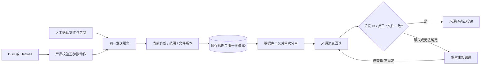

# 企业附件发送与对账

2026-10-31；P02/P04/P07/P08、C00/C02/C05/C07、A03/A04/A06/A10、E01/E02/E04/E07/E08/E09/E10 子集。当前实现从当前员工的 Nextcloud Files 选择已有文件，直接或经 DSH/Hermes 分享到确切 Talk 会话。本机上传在后续 [上传模块](ATTACHMENT-UPLOADS.md) 接入，使用同一分享确认方案；完整本机上传证据以该模块为准。

## 业务输入与统一服务

人工 `POST /api/talk/rooms/:room/attachments` 与 `share_attachment` Run 的 `attachment.share {}` 使用同一 `AttachmentSendService`。严格确认方案包含房间 token、受限分段路径、文件 ID、DAV etag、最多 2000 字说明与 `confirmed=true`。界面选择文件/修改说明或执行方式后清除确认；AI 不能选择接收方、路径、权限或代写确认。首版支持 8 MiB 内文件。

人工可选择当前可读、非只读会话。AI 额外要求当前项目明确关联同一房间；未关联时引导使用“项目空间”，不会借用另一个项目或自动创建身份。模型只收到必要文件元数据、房间和已确认说明，不收到文件正文、挂载路径、凭据、会话讨论或来源分享 token。模型原始宣称不作为送达证据，不写入共享项目讨论。

业务在模型前、执行前、实际 POST 前检查来源与文件版本；事务内核对当前 Run/租约、规则、员工、来源 UID/凭据与项目绑定。源 Files 能读不保证有转分享权；分享能力由 Nextcloud 最终执行。每次请求固定 `shareType=10`、当前房间与 `permissions=1`，不创建公开链接，不扩大执行器工具权限；已有更宽的文件授权不会自动收紧。

## 外部动作与证据

开发验证曾发现 JSONB 返回字段顺序与输入对象不同会造成错误拒绝；当前先用严格方案 schema 归一，再比较方案摘要。记录对象键顺序不能作为业务目标发生变化的证据。

迁移 023 增加 Run 确认方案与 `cw_attachment_sends`。意图包含主体/凭据引用、来源、房间、确认方案、文件名、唯一关联 ID、源分享/消息 ID、源 Run、状态与时间；不保存原始字节或分享口令。键在员工/工作区内唯一，相同键返回旧回执，不重复 POST；不同方案不能借用同键。当前房间有未核对附件时阻止新的附件意图。

持久意图先于外部请求。外部网络请求不占数据库长事务；在请求前持久记录 attempted_at。每条请求只尝试一次 OCS 分享，随后按**唯一关联 ID + 原员工 UID + 文件 ID**读取实际房间消息。只有回读匹配才记 `succeeded`；这说明来源存在分享消息，不代表成员已阅读、下载或完成工作。附件是活文件引用，发送前 etag 核验不提供跨 DAV/OCS 的原子文件快照。

来源分享应答仅保留非秘密分享 ID；没有应答也可凭严格消息回读确认。固定 Talk 的重复分享会先产生事件再返回 403，不能把所有 4xx 当成无副作用。协议依据：[固定版本重复分享路径](https://github.com/nextcloud/spreed/blob/v23.0.12/lib/Share/RoomShareProvider.php)、[系统消息与 referenceId](https://github.com/nextcloud/spreed/blob/v23.0.12/lib/Chat/SystemMessage/Listener.php)。JSON 文件字段仍按[接收契约](MESSAGE-ATTACHMENTS.md)处理。

投递前已知拒绝为 `failed`；POST 一旦尝试，超时、断网、不匹配或回读不可用均保留 `recovery_required`。即使外部已写入但 Run 动作记录保存失败，也不能降成确定无副作用的失败。模型完成、HTTP 201、加入队列、手动继续与来源回读分别呈现，不互相代替。

## 恢复、取消与可见范围

`GET /api/talk/rooms/:room/attachment-sends` 返回当前员工的待核对意图、近期 AI 执行与近期回执。`GET /api/talk/attachment-sends/:id` 可读取个人回执；reconcile/acknowledge 为该路径下 POST。45 秒未结束的 sending 进入待核对，服务重建后继续使用同一关联 ID。核对仅查询来源，不重发；最近 100 条没找到不证明未投递。员工明确“已查看来源，继续发送”只解除阻塞，未知事实不会变成成功或撤销。

每次读取/核对要求当前工作区、来源身份与会话权限；另一员工不能通过 ID 读取回执，移除成员后旧意图不可访问。界面刷新后恢复排队/未知状态，切换房间或拒绝读取时清理选择、模型与迟到响应。来源正文不写向量或执行器本地记忆。

Run 取消阻止后续步骤；已发出的 HTTP 无法据此回滚。投递中的真实分享事实独立保存，即使 Run 已 cancelled；需要人核对时保留回执。不会自动删除分享、撤回源消息或删除原文件。规则/租约/身份变化后不允许借旧 Run 继续扩大范围。

## 部署、回退与当前证据

依赖沿用 Files/Talk 当前员工连接、PostgreSQL、独立 Worker、既有模型配置；无新服务或密钥格式。启动前应用 `023_attachment_sends.sql`，再更新 API/Worker/Web。回退先停止新附件执行、核对进行中的请求，并在当前版本移除规则允许列表中的 `share_attachment`，再切回代码；旧版规则 schema 不能解析新的工作流名称。保留新表、Run 方案和意图，不能通过 DROP 表抹去可能已发生的来源动作。原文件/消息不自动回滚。

本地 147 数据库测试通过（新增 8 项，涵盖重复 403、断网、严格回读、取消、撤权、回执保存失败）；25 单元、类型/构建、企业消息 5 UI 和完整 45 UI 首轮通过；桌面/手机截图已检查。修正实现 `a6f1b8422eed649c164e59a6569441ca22e21a1c` 的 [CI 41120571893](https://github.com/MkaliezZ/hyper-workspace/actions/runs/41120571893) 三个 job 全部成功，共 246 项通过：25 单元/配置、3 下载器、8 解析、147 数据库、4 原生执行器、45 UI、10 真实来源、4 容器；另含类型、构建、两个 npm 审计与冻结包。真实 Nextcloud 合成账号实测人工分享/幂等、真实重复分享事件、双引擎实际投递、双方下载及移除成员/删除原件；没有以 UI fixture 代替来源证据。原生执行器使用协议模型，尚未验收该工作流的真实供应商质量、公司实际资料和规模。

本发送增量未验证本机上传（后续证据见上传模块）；尚未验证真实公司资料/规模、真实供应商对该新工作流的质量、Safari/Firefox、完整 E01–E10 与生产交付。来源路径在跨系统请求之间仍可能变化；不承诺严格一次外部副作用、跨系统原子版本/权限、接收端离线副本召回或引擎私有检查点迁移。

## 首轮来源回归记录

实现 [ac799a0](https://github.com/MkaliezZ/hyper-workspace/commit/ac799a053c28ed4803182277a6e36d4038fa87f4) 的 [CI 41118788352](https://github.com/MkaliezZ/hyper-workspace/actions/runs/41118788352) 中，verify 与 deployment 成功，来源 8 过/2 失败。新增附件场景的人工/幂等、重复分享、DSH/Hermes 投递和下载/撤权均通过；两个旧用例仍等待硬编码默认标题“团队讨论”。来源项目按名称参与选择，新场景建立项目后登录页可合法显示另一项目，因此该标题不代表是否已认证进入工作区。修正为检查工作区导航可见；保留双方消息、单聊/群聊、来源 UID、幂等和移除成员的原断言，不更改产品默认选择或放宽来源权限。修正提交 `a6f1b84` 的完整 CI 41120571893 三个 job 成功，246 项全部通过，45 UI 与 10 来源用例均未依赖重试；首轮失败记录保留。
