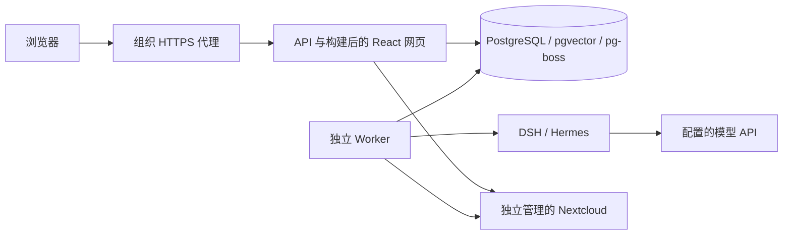

# Docker Compose 自部署

对应 P04/P07/P08、C05/C07、A01/A08/A10、E09/E10 的运行与恢复子集。技术基线不变：React/TypeScript、NestJS、独立 Worker、PostgreSQL/pgvector/pg-boss、DSH 默认与 Hermes 兼容。当前仍是开发版；Linux amd64 容器基础与恢复子集已在 CI 通过，生产验收待完成。

## 包含的服务



Compose 启动数据库、一次性迁移/工作区初始化、API 与 Worker。API/Worker 使用同一个构建镜像，包含相同版本的执行器；API 提供 `apps/web/dist` 的已构建网页，不运行 Vite。Nextcloud 保持独立来源，需使用已配置的兼容实例；本包不自动创建来源员工、群组、分享或产品管理员。

API/Worker 使用 UID/GID 10001、只读根文件系统、去除 Linux capabilities、临时 `/tmp`。只有 Worker 挂载 `runs` 写入卷，数据库使用 `database` 卷；默认不挂载主机目录或 Docker socket，不公开 PostgreSQL 端口。产品端口只绑定主机 `127.0.0.1:8080`，供本机访问或组织代理转发。执行器原生工具仍关闭，这些设置不等于完整生产沙箱或隔离验收。

数据库管理员连接仅用于 PostgreSQL 与 `initialize`；API/Worker 改用独立 `hyper_runtime`，可写业务数据并管理队列 schema，不能管理数据库或修改业务表结构。旧配置需补充独立运行密码；[账号权限、旧卷升级、失败与回退说明及通过证据](DEPLOYMENT-DATABASE.md)。角色分离后的 3 项容器权限/双执行器/恢复用例已通过 CI。

## 准备与首次启动

准备有 Docker Engine、BuildKit 和 Compose 2.17+ 的 Linux 主机，构建使用 `additional_contexts`。本机开发仍可按 README 的 Node/PostgreSQL 方式运行；容器支持范围先按 CI 的 Linux amd64 验证，不从基础镜像的多架构清单推导出 ARM/Windows 已验收。

```bash
git clone https://github.com/MkaliezZ/hyper-workspace.git
cd hyper-workspace
node scripts/deploy-init.mjs
```

配置生成器需要 Node 24；它以 0600 创建 `.env.compose`，生成独立的管理员密码、运行密码、凭据加密主密钥和工作区 UUID，拒绝覆盖已有文件，不打印秘密。该文件被 Git 与 Docker build context 排除。之后在本机编辑该文件：

| 配置                                   | 含义                                                                                                              |
| -------------------------------------- | ----------------------------------------------------------------------------------------------------------------- |
| DB_PASSWORD / DB_RUNTIME_PASSWORD / CREDENTIAL_MASTER_KEY | 生成器创建的三个独立 64-hex 秘密；管理员密码仅供数据库与初始化，API/Worker 使用运行密码 |
| APP_ORIGIN                             | 员工使用的规范 origin，无末尾 `/` 或路径，例如 `https://workspace.example.com`；生产模式仅本机 loopback 允许 HTTP |
| HYPER_PORT                             | 代理访问的主机 loopback 端口，默认 8080；容器内部仍为 3100                                                        |
| NEXTCLOUD_URL                          | 浏览器和来源 Login Flow 返回的规范公开地址，通常为组织的有效 HTTPS 地址                                           |
| NEXTCLOUD_INTERNAL_URL                 | 可选的受信内部传输地址；不能用它掩盖公开地址/来源返回 URL 不匹配                                                  |
| NEXTCLOUD_MEMBER_GROUP                 | 明确允许进入产品的来源群组                                                                                        |
| NEXTCLOUD_BOOTSTRAP_ADMIN_IDS          | JSON 数组，精确来源 UID；只用于首次角色映射，来源 admin 不自动成为产品 admin                                      |
| WORKSPACE_NAME                         | 初始化工作区名称，默认 Hyper Workspace                                                                            |
| NEXTCLOUD_TALK_ENABLED / FILES_ENABLED | 完成相应来源配置后显式启用，默认关闭                                                                              |

保持 `DEMO_MODE=false`。首次初始化在企业身份配置缺失时拒绝启动，不自动改用演示资料。详见 [身份配置](NEXTCLOUD-IDENTITY.md)、[Talk](NEXTCLOUD-TALK.md)、[Files](NEXTCLOUD-FILES.md)。容器内的 `127.0.0.1` 指向该容器；来源必须通过容器可达的地址访问，组织代理的公开 URL、trusted domains、证书和来源返回地址也需一致。

```bash
docker compose --env-file .env.compose config --quiet
HYPER_REVISION=$(git rev-parse HEAD) docker compose --env-file .env.compose up -d --build
docker compose --env-file .env.compose ps
```

先等待数据库健康；`initialize` 成功迁移全部 SQL 并幂等初始化企业工作区后，API/Worker 才启动。应用仅在数据库可访问时通过 `/api/health`；Worker 的健康文件只在后台进程完成数据库探测后刷新。检查初始化和服务日志时，不输出完整 `docker compose config` 或容器环境变量。

通过组织 HTTPS 代理访问后，在 Nextcloud 授权窗口完成企业登录，再在设置中保存 chat/embedding 模型连接。启动成功与模型 Key 验证成功不代表真实执行器业务或模型质量已经验收。开发版容器没有管理 Nextcloud 生命周期的权限。

## 代理、配置与数据

本机附件上传使用单独二进制路径 `PUT /api/talk/attachment-uploads/:id/content`，最多 8 MiB。组织代理须允许此路径的 8 MiB 请求（例如该 location 的 `client_max_body_size 8m`），其余路径保留原限制。API 先认证，再做此路径的有界解析；不用放宽所有 JSON 请求。[上传、迁移 024 与回退](ATTACHMENT-UPLOADS.md)。

容器显式 `API_HOST=0.0.0.0`；本地开发默认仍为 loopback。`SERVE_WEB=true` 仅提供固定构建目录；`/api` 继续进入业务接口，私有运行目录、`.env` 和源码不作为静态资源提供。HTTPS origin 使用 Secure cookie，本机 HTTP loopback 使用 HttpOnly/SameSite cookie；没有放宽演示登录的来源 socket 限制。

组织代理需保留请求路径与 Origin、使用有效 TLS 证书，并为事件流关闭缓冲。例如 Nginx 的 upstream 可指向 `127.0.0.1:8080`，`proxy_buffering off`，`proxy_read_timeout 75s`；组织域名、证书、公司 SSO/MFA 和私有 CA 尚需在公司环境验证，不关闭证书校验来绕过连接问题。

`database` 卷保存产品资产、版本、会话、角色与加密模型/设备凭据；`runs` 卷保存 Worker 的任务文件，个人文件阅读的运行目录按既有生命周期清理。不要用执行器目录代替企业资产备份。保留 `.env.compose` 的受限备份；随意重新生成主密钥会让已有密文无法解密，数据库密码更改也要配合实际数据库用户改密。自动密钥轮换尚未实现。

```bash
# 停止服务，保留数据卷
docker compose --env-file .env.compose down
# 同一配置与数据卷再次启动
docker compose --env-file .env.compose up -d
# 将产品数据库备份到受控位置
docker compose --env-file .env.compose exec -T db pg_dump -U hyper -Fc hyper > /path/to/private-backup/hyper-backup.dump
```

备份包含企业资料与密文，需与主密钥分开受控保存。数据库管理/运行角色分离已通过 CI；正式恢复演练、备份保留、负载容量、费用策略和主机加固尚未完成。`down --volumes` 只用于本仓库的隔离 CI 清理，不能作为保留企业数据的停止方式。

## 升级与回退

先备份并保留配置，核对目标提交、镜像 ID、依赖锁与迁移，再停止新任务并核对正在执行的 Run。构建新镜像后 `up -d --build` 会按迁移/健康依赖启动；不要通过手改已应用 SQL 来回退。涉及来源项目、Files、个人解读数据时，旧代码若不认识来源绑定，可能扩大访问范围，必须遵守各模块的回退说明，优先向前修复。

API 与 Worker/数据库重启后，业务对象与历史保存在 PostgreSQL。执行中断后等待租约核对，进入 `recovery_required`，不自动重放业务动作；这不等于自动回滚或已完成全部恢复演练。

## 锁定与证据

- Node `24.14.1-bookworm-slim`，OCI index `sha256:b506e7321f176aae77317f99d67a24b272c1f09f1d10f1761f2773447d8da26c`；npm 11.11.0。
- Python `3.14.6-slim-bookworm`，OCI index `sha256:4c92ffcde4dd6f1ff72a24518f49fd4990b27134987dfa31a733badde66df9f8`。
- PostgreSQL/pgvector 沿用既有固定镜像摘要；DSH 与 Hermes 沿用原锁文件与源码/包完整性检查。具体组合见 [runtime-lock.json](runtime-lock.json)。

上述摘要于 2026-10-29 通过 Docker Registry v2 manifest 响应核对。系统 apt 依赖随发行仓库安全更新，镜像内记录 `runtime/image-packages.txt`，镜像标记源码 revision；这不是位级可重复构建或所有 OS/Python 包安全审计。

首次容器 [CI 40903087059](https://github.com/MkaliezZ/hyper-workspace/actions/runs/40903087059) 的三个 job 均停在固定 Hermes 源码下载 HTTP 429，当时未运行容器业务断言。下载器增加有界重试、缓存摘要复核，CI 仅缓存公开源码归档并通过只读独立构建上下文复用；不上传 `.runtime` 内的其他数据，也不改变原提交、源码 SHA-256 或上游依赖锁。缓存损坏直接失败，3 项下载回归已在本地与后续 CI 通过。

第二轮 [CI 40904981867](https://github.com/MkaliezZ/hyper-workspace/actions/runs/40904981867) 下载已成功，容器构建在启动前因 BuildKit secret 的 500 KiB 上限拒绝 89 MB 公开归档。构建输入现改为只包含这份归档的命名上下文，经只读 bind mount 读取并重新校验；主构建上下文继续排除 `.runtime` 和 `.env`。默认 Compose 的该上下文只有说明文件，未准备归档时仍从固定 URL 下载。直接 `docker build` 时须提供 `--build-context hermes_source=runtime/hermes/build-context`，日常部署使用上方 Compose 命令即可。

本地通过类型/构建、15 单元/Provider/部署配置、49 数据库、18 UI 回归；编译后的 API 在独立本地端口直接提供网页，验证正常登录、HttpOnly cookie、私有路径拒绝、桌面/手机无溢出。首次复用测试库时，其最后一项撤权测试让演示成员失效，静态登录验证失败；仅对隔离测试库重新 seed 后复测，未放宽鉴权。

提交 `5a0cb37125661da261b96b841dcf23d6db0d022a` 的 [CI 40906030218](https://github.com/MkaliezZ/hyper-workspace/actions/runs/40906030218) 三个 job 均成功，共 98 项测试。独立 `deployment` job 在 Linux amd64 从干净镜像构建、启动 Compose，2 项用例均通过：构建网页/私有路径/原 socket 演示登录边界，原生 DSH 创建与 Hermes 对同一成果修订，数据库/API/Worker 停启后会话/密文模型配置/成果版本保留，以及中断 Worker 后进入 `recovery_required` 而不重放模型调用。模型为内部合成协议服务，没有公司数据或真实供应商 Key。

本机无 Docker；容器结论来自真实 CI，本地静态 HTTP 验证单独记录。后续角色分离提交 `42facee` 的 [CI 40913709891](https://github.com/MkaliezZ/hyper-workspace/actions/runs/40913709891) 三个 job 全部成功，共 103 项测试，包含 3 项容器权限与恢复用例。真实公司 HTTPS/SSO、真实模型质量、完整 E01–E10、备份恢复演练和全面生产隔离仍未验收。

依据：[Compose 启动依赖](https://docs.docker.com/compose/how-tos/startup-order/)、[独立构建上下文](https://docs.docker.com/reference/compose-file/build/#additional_contexts)、[多阶段构建](https://docs.docker.com/build/building/multi-stage/)、[官方 Python 镜像构建定义](https://github.com/docker-library/python/blob/master/3.14/slim-bookworm/Dockerfile)。文档分支只作说明，实际版本以摘要与 CI 为准。
