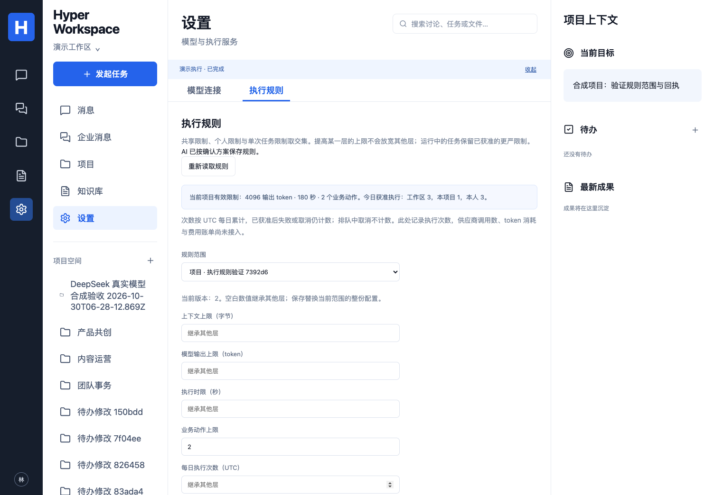

# 执行规则与次数额度

映射：P03/P04/P07/P08、C05/C07、A01/A10，E03/E04/E09/E10 子集。此实现补充产品规则执行，不修改冻结 Policy Pack，也不表示完整 C07 或 E01–E10 已验收。

## 使用

打开“设置 → 执行规则”，先选择范围。工作区管理员可以调整工作区和项目规则；成员只能调整自己的规则。共享权限来自数据库当前角色，模型参数、显示名和历史管理员身份均不能授予权限。

数值留空表示继承，保存替换当前范围的整份配置。规则支持上下文字节上限、输出 token 上限、执行秒数、业务动作数、UTC 每日执行次数、执行器/工作类型允许集合，以及简洁/适中/详细的表达偏好。列表未配置时继承；配置空列表表示禁止全部。“发起任务 → 本次执行限制”可进一步收紧单次执行。

人工直接保存与 AI 代保存调用同一服务。AI 入口必须由员工先确认完整结构化方案；模型只能提出一个 `policy.configure {}`，不能改范围、参数、版本或权限。AI 禁用或次数用尽后，仍可由有权人员直接保存规则。此次不包含自然语言自由修改公司制度。

[手机界面](images/execution-policy-mobile.png)。页面样例均为合成资料。

## 组合与执行边界

- 固定上限：100000 上下文字节、4096 输出 token、180 秒、30 个业务动作；产品允许配置更小值。
- 组织（当前部署工作区）→项目→个人→单次任务。硬限制取最小值，允许集合取交集；表达偏好按更具体的范围覆盖。个人偏好不能扩大共享权限。单次任务不单独设置每日额度。
- 个人文件 Run 不继承无关项目规则，但仍受工作区/个人规则限制。身份、项目及源系统权限继续独立检查；规则允许某工作类型不等于获得来源权限。
- Worker 在派发时保存具体规则层、版本、任务限制、有效限制和获准时间。排队期间收紧规则会在调用模型前生效；进行中的任务保留已获准的更严硬限制，后来放宽规则不会扩大本次授权。
- 模型前、模型后、每次业务写入及普通结果发布前重新检查。规则写入与业务动作使用工作区事务锁，防止规则变更和产品写入交错；后台约每秒检查限制，来源权限仍按原来的至多 15 秒周期检查且在动作前重验。
- 两执行器均收到本次输出上限。已发送给供应商的请求不能被撤回为“没有调用”；运行中降低输出上限不改写已发请求，后续派发使用新上限。停止可能仍产生供应商消耗，已完成动作保留回执或进入待核对。
- 上下文字节只统计选定上下文和员工指令；固定系统/执行协议提示不计入此字段。它不是输入 token 数或供应商计费估算。Hermes 内部运行预算可能更早截止，产品时限是上限。

## 次数与回执

每日次数记录的是 Worker **获准执行**的 Run，采用 UTC 日界，工作区/项目/个人分别计数。并发检查和登记在同一事务完成，不因两个 Worker 同时读取而突破上限。相同 Run 重复投递不重复计数；排队中取消不计数；获准之后失败或取消仍计数。历史日不占今日额度。

此次数不能当作模型请求数、token 用量或货币费用。一次原生执行器可能有内部请求；模型连接验证和 embedding 等非 Run 调用不包含在当前计数中。实际 HTTP 用量现由独立的 [用量服务](MODEL-USAGE.md) 记录；价格版本、费用估算及按连接金额预留见 [价格与预算](MODEL-SPENDING.md)。跨连接组织/项目预算、自动账单对账和组织通知偏好仍待实现。

每次规则变更保存独立审计记录（主体、范围、旧/新版本关系、新规则、幂等键、人工/AI 来源 Run、实际回执）。版本不符拒绝覆盖，重复请求回放原回执；审计写入失败整笔回滚。模型配置、Key 和企业原文不写入规则快照。个人 Run 的快照和回执沿用发起人可见范围。

API：`GET/POST /api/projects/:id/execution-policy`。POST 使用 `ExecutionPolicyInput`（scope、expectedRevision、rules、confirmed=true、idempotencyKey）；范围 ID 由服务端绑定。AI 使用 `RunInput.workflow=configure_policy` 与相同的 policyPlan。`RunInput.taskRules` 只能补充约束；`getRun.executionPolicy` 和 `run.started` 包含实际派发快照，`usage.updated.kind=execution-admission` 明确只是次数。

## 迁移、回退与验证

迁移 `018_execution_policies.sql` 新增规则、变更审计、获准次数表及 Run 附加列。沿用部署迁移角色执行并重新授予运行角色表权限（见 [部署教程](DEPLOYMENT.md)）。默认未配置层继承原固定限制，旧完成 Run 的快照为空，不伪造历史。

回退前停止新派发，排空/停止并核对 `configure_policy` Run 后再部署旧版代码；保留新增表、历史快照与回执，避免删除审计。配置恢复通过有权人员读取当前版本后保存，不直接覆盖历史。

本地验证：104 项完整数据库回归（含 9 项规则测试）；19 项单元/配置、类型和构建通过。3 项真实 DSH/Hermes/往返切换测试扩展了同一规则业务与真实 HTTP 请求 `max_tokens=128` 检查，全部通过。模型 endpoint 为明确合成协议夹具，未在此轮花费真实模型额度。完整 38 项浏览器回归通过，新增场景覆盖桌面 1504×1045/手机 390×844，实际截图已查看；Browser plugin not available，使用项目 Playwright Chromium，Safari/Firefox 未测。执行规则提交 `8463fb1` 的 [CI 41029145378](https://github.com/MkaliezZ/hyper-workspace/actions/runs/41029145378) 三个 job 全部成功、188 项首轮通过。后续用量增量证据单独记录，不混用本次 CI。
