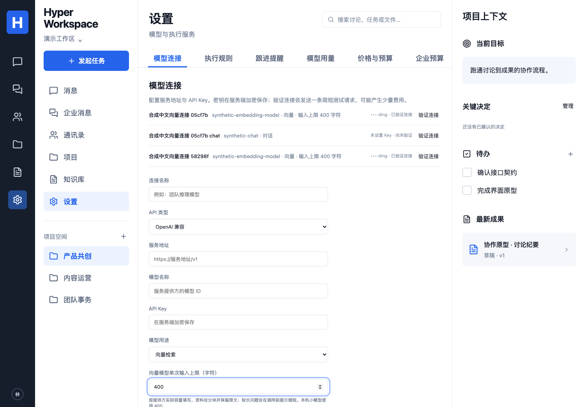

# 本机中文向量服务

映射 P02/P04/P07、C02/C07、A04/A06/A10、E02/E04/E07/E09 子集。用户授权后可把同一份可选开源模型用于个人开发工作区；产品核心、两执行器和向量资产所有权保持原基线。

使用 MIT 的 BAAI/bge-small-zh-v1.5，经固定 Xenova ONNX 转换，在 CPU 生成 512 维向量。模型权重约 24.6 MB，Node 推理依赖另占数百 MB。不需要购买 embedding API 额度，也没有本机推理的外部供应商按次费用；会占 CPU、内存、磁盘和电力。它负责语义检索，对话仍使用单独的 chat 连接。[模型卡](https://huggingface.co/BAAI/bge-small-zh-v1.5) · [权重锁](../runtime/evaluations/embedding-model.lock.json)。

## 安装、状态与停止

本次验证平台为 macOS Intel、4 核 CPU、16 GB 内存、Node 24。运行于宿主机；`127.0.0.1` 不能直接作为另一个 Docker 容器访问宿主服务的地址。其他系统可使用前台服务，但不能据此声称完成对应平台的常驻部署验收。

在仓库根目录执行：

```bash
npm ci --prefix runtime/evaluations --ignore-scripts --registry=https://registry.npmjs.org
npm audit --prefix runtime/evaluations --audit-level=high --registry=https://registry.npmjs.org
node runtime/evaluations/download-embedding.mjs --execute
node runtime/evaluations/local-service.mjs --init
node runtime/evaluations/local-service.mjs --install
node runtime/evaluations/local-service.mjs --status
# 更新本机服务代码/依赖后部署并重启
node runtime/evaluations/local-service.mjs --restart
# 停止且取消本次 launchd 加载，保留配置和模型；需要时 --install 恢复
node runtime/evaluations/local-service.mjs --stop
```

不带参数只预检；不会下载、安装或启动。`--serve` 是前台运行方式。登录服务为 `com.hyperworkspace.embedding`，只监听 `127.0.0.1:3116`。macOS 登录服务不直接读取受保护的 Documents 仓库：安装器将自有运行文件、依赖、模型和私密配置部署到 `~/Library/Application Support/Hyper Workspace/embedding`，LaunchAgent 位于 `~/Library/LaunchAgents/`。需要同一系统用户登录；本次实测启动/停止/重启，未声称实际重启整台电脑后的验证。

服务使用独立随机访问凭据，配置文件为 0600、目录 0700；重复初始化保留凭据。原配置在忽略目录 `.runtime/local-embedding/config.json`，部署副本同样受限；不要上传、打印或发到聊天。安装器核对工作目录归属，拒绝覆盖另一 checkout 的服务或不一致的访问凭据。升级前停止服务，避免覆盖运行中的原生库。

## 产品连接和文档长度



模型设置使用 OpenAI 兼容协议、地址 `http://127.0.0.1:3116/v1`、模型名 `local-bge-small-zh-v1.5-q8`、用途“向量检索”、单次输入上限 **400 字符**，凭据只交给服务端加密保存。工作区连接须由当前管理员保存。健康检查不表示已经保存或验证产品连接；“验证连接”会实际计算一条短文本。

迁移 `042_embedding_input_limits.sql` 为连接加入容量设置，默认 4000 字符以兼容既有连接。新小模型必须设 400：产品按容量将正文完整分块并保留原始位置引用，标题过长时仅省略检索提示前缀，标题原文仍保存在元数据。单份原文仍受十八万字符的产品上限约束。查询超过配置容量会在 HTTP 调用前提示缩短，不静默截断。服务还检查 512 token 实际容量，拒绝越界输入。

容量发生变化时，旧向量与新索引空间分开，须重建；不能把不同容量/模型的向量混用。撤权、来源版本、删除、当前员工身份与既有模型预算检查仍由产品执行。token 来自真实本地分词器；费用账本没有自动写入虚构发票或覆盖 DeepSeek 计价，未配置单价的请求仍显示未计价。

## 验证和维护边界

固定八组中文检索题的评分与独立长文末尾检索在 [SEMANTIC-QUALITY.md](SEMANTIC-QUALITY.md) 记录。原文覆盖和字符引用、私人/撤权/旧版本/删除过滤经过产品 ModelProvider、KnowledgeService 和 pgvector；这不能代替公司术语、真实企业语料、生成式回答质量或生产吞吐验收。

可选运行时使用 Transformers.js 3.8.1、ONNX Runtime Node 1.23.2、sharp 0.35.5、adm-zip 0.6.1 独立 lockfile。ONNX 较新发行包未提供本机所需的 macOS x64 预编译绑定；当前组合需要实测。退出时先关闭 HTTP、等待队列、释放模型，再自然结束 Node 事件循环，避免旧版本在强制 `process.exit()` 时的原生静态析构问题。[上游诊断与 Node 修复讨论](https://github.com/microsoft/onnxruntime/issues/24579?timeline_page=1)。不隐藏退出失败，也不通过静默截断或更换评分题目绕过限制。

数据库备份保留产品连接的加密配置；模型权重可以按锁重新下载。常驻服务私密配置必须另外受限备份，才能继续使用原访问凭据。使用同一主密钥恢复产品库后仍须实际验证连接；不能重置其他模型 Key 来修复这条连接。
