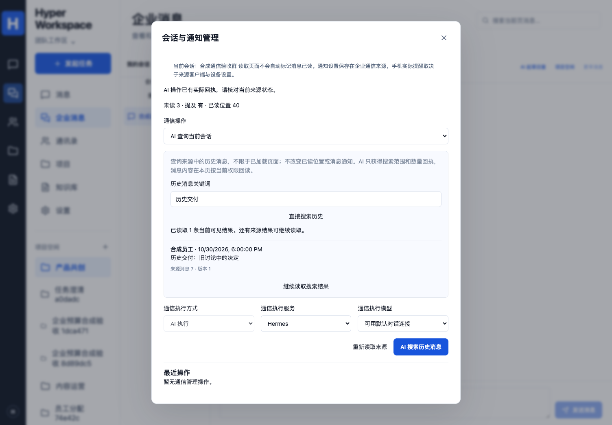

# 当前会话的历史消息搜索

对应 P02/P04/P07/P08、C00/C02/C05、A01/A03/A10、E02/E04/E07/E09/E10 的通信检索子集。固定栈、DSH 默认和 Hermes 兼容、原始消息由 Nextcloud 权威保存的边界保持不变。

## 使用与完成标准

企业消息页先选择会话，再选择“搜索历史消息”。该入口直接打开会话管理中的只读查询，可输入关键词直接搜索，也可选择 DSH/Hermes 后使用“AI 搜索历史消息”。页顶原有输入框仍明确标为当前页过滤；历史搜索由来源的查询 API 执行，可以找到未加载到页面的旧消息。

结果显示当前原文、作者、时间、消息 ID、版本及由可信来源地址构造的查看链接。每次最多读取 20 个来源候选，后续结果由来源游标显式翻页；页面最多保留 200 条，再提示缩小关键词范围。结果为空不代表会话没有历史，只表示此来源搜索范围中没有当前可返回的匹配消息。

读取不设置已读标记、不清除消息通知。不会把来源聊天复制进产品共享消息表或向量库。查询词可以保存在发起者自己的 Run 计划中；模型上下文没有查询词或私密消息，执行回执仅保留当前会话、数量、后续页状态、检查时间等事实。完整内容由界面经相同产品服务重新读取。

## 人工和 AI 入口

- `GET /api/talk/rooms/:id/search?q=…&bindingRef=…&cursor=…`：当前员工来源身份；`bindingRef` 从当前 `/talk/management` 读取，不接受客户端自报管理员或来源地址。关键词 1–200 字符、不允许控制字符，游标是有界非负整数。
- `POST /api/talk/management/runs`：沿用 `manage_communication`、`communication.manage` 空参数工具及固定来源计划。计划为 `operation=read`、明确 `roomId` 和 `search={query,cursor?}`；不带会话的历史搜索拒绝。
- 人工读取和模型指派的读取均调用 `CommunicationSearchService`，模型不能换员工、会话、查询或游标。两引擎共用产品 Run、执行规则、预算与实际回执，不持有源服务密钥。

## 来源协议和权限

锁定 Nextcloud 33.0.10 / Talk 23.0.12。使用 Core Unified Search 的 `talk-message` provider，发送明确的 `conversation` 过滤；不需要用网页当前路由推测目标，也不把其他会话结果混入当前会话。[Core 查询协议](https://github.com/nextcloud/server/blob/v33.0.10/core/Controller/UnifiedSearchController.php) · [固定 Talk 会话过滤与结果字段](https://github.com/nextcloud/spreed/blob/v23.0.12/lib/Search/MessageSearch.php)。

服务先确认当前员工仍在源会话，搜索后核验所有候选的会话、消息 ID、唯一性和递增游标。搜索响应信封限制 1 MiB，候选最多 20 个；忽略来源摘要、缩略图与任意 URL。每 4 个候选并发回读确切消息位置，使用关闭已读/通知更新的原生历史接口；已删除、过期、改成不匹配内容的候选不返回，编辑后的正文使用当前回读。最终再次核对来源绑定、产品/设备凭据及源会话权限。

来源绑定变化、身份吊销或移出会话时拒绝返回原内容；产品管理员不能扩大源权限。界面按用户、绑定和会话隔离，关键词变化、关闭或失权时取消旧请求并清除旧结果，迟到响应不得恢复内容。没有将浏览器缓存或模型文本当作当前权限依据。

来源拒绝、不支持搜索、无效/超大信封、混入其他会话或游标不前进时明确失败；不静默降级成当前 100 条消息后声称搜完。查询是只读操作，可以明确重试；AI Run 仍沿用原键找回、取消和回执机制，不因网络超时自动重发模型请求。Nextcloud 自身的可搜索消息类型、联邦会话/大厅等限制仍适用；这不等同于全公司跨会话、附件内容或语义消息搜索。

## 验证范围

本地新增 5 组数据库/真实 HTTP 协议用例：旧消息超过最新 100 条、23 项分页/原文定位、编辑/删除/过期过滤、恶意摘要/URL/跨会话/重复 ID/游标拒绝、凭据和成员撤权，以及人工/AI 共用服务。相关通信管理 27 项及整库 252 项通过。双原生执行器实测同一只读计划，新增两个真实引擎请求；既有 5 次来源写入断言不变，搜索不增加写入。

页面新增人工分页、Hermes 计划、AI 后重新读取、失权清理和手机布局检查，通信页 6 项通过。首轮新用例的精确 label 定位失败已保留，改为现有 combobox 可访问名称后原断言完整通过；未放宽权限断言。

真实 Nextcloud 新增独立合成员工用例：旧目标后追加 102 条新消息，两引擎只读检索、源位置回读及被移出后的拒绝。此用例须按本代码提交的 CI 另核对，本机未安装 Docker，不把协议服务当真实 Nextcloud。上述也不代表公司语料、真实供应商搜索理解质量或正式 E01–E10 全量通过。
