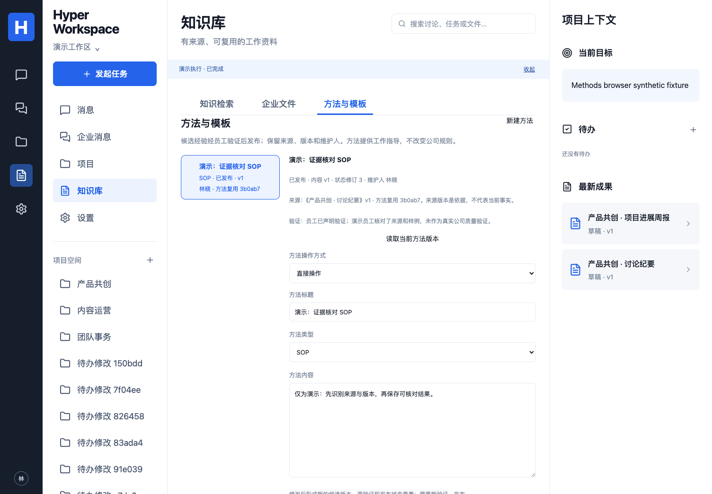

# 方法、模板与案例资产

对应 P04/P05/P06/P07/P08、C02/C04/C06/C07、A06/A07/A08/A09/A10，验证 E01/E02/E04/E05/E06/E07/E09/E10 子集。固定技术与三层定义不变，原冻结验收状态不改。

## 员工操作

“知识库 → 方法与模板”可从当前项目的已保存成果版本整理 SOP、模板、案例、质量量规或术语。人工与 AI 共用同一个方法服务；内容保留维护人、来源成果 ID/版本和内容版本。

1. 选择来源成果，人工保存或让 AI 整理候选。AI 仅使用选中的成果/已保存方法与员工指令，不读取项目讨论；未保存编辑不发送给模型。
2. 维护人或有当前来源访问权限的工作区管理员核对候选，填写验证依据并确认。“员工已声明验证”是员工声明，不能解释为模型独立验证或真实公司质量评估通过。
3. 确认发布范围和当前版本，再发布。项目发布可由维护人或管理员操作；工作区发布需要当前工作区管理员。来源绑定企业会话的方法仅支持来源项目内发布/复用，不能借工作区发布扩大来源权限。
4. 选择已发布的确切版本，用于讨论转纪要与待办、周报或修订已有成果。方法是工作指导，不是公司规则、授权或项目当前事实。模型费用沿用所选连接。
5. 内容修订形成新候选，清除原验证依据和发布状态，须重新验证/发布。撤回会停止新复用，也阻止模型在途结果依据旧方法提交新的业务动作；已有成果与历史保留，不宣称撤销已经提交的动作。

[手机界面](images/methods-mobile.png)。界面保持蓝白黑；AI 完成后保留人工输入，只刷新状态与历史，显式读取当前版本才替换。AI 修改要求和成果复用要求使用独立草稿，切换方法/新建对象会清空旧对象的要求和修改目标，避免跨操作覆盖或沿用。关闭/切换后的迟到响应不会恢复旧项目或执行。

## 权限与资产

候选和撤回记录由维护人及有来源访问权限的管理员管理；普通同事只读取当前已发布方法，其历史只包含曾发布的内容版本和发布记录，不泄露未发布旧稿。知识检索/向量索引仅收录已发布方法。旧演示 seed 的方法资料不自动升级为受治理的正式方法记录。

每次读取、管理、复用和索引沿用当前成员与 ProjectAccess。工作区级方法只有来源不绑定企业会话的项目才可发布，跨项目使用仍需源和目标访问权限。发布不改变源系统 ACL，管理员身份不绕过来源权限。源权限与产品事务没有跨系统原子性，存在核验后的在途窗口；边界同 [来源项目契约](PROJECT-SOURCE-SCOPE.md)。

原始成果版本是方法的历史依据；源成果后续更新不自动宣称旧方法失效或仍然正确，维护人需核对适用性、修订或撤回。来源访问失效时，即使缓存仍有正文，也不能读取或复用。

方法目录、版本、操作回执与复用记录由产品 PostgreSQL 持有，不依赖 DSH/Hermes 私有状态。`cw_assets` 是方法检索副本；其源版本使用 `内容版本:状态修订号`。每次修订、验证、发布、撤回都清除旧向量，索引和返回结果复核权威方法状态、版本及资产绑定；缓存标志或来源字段错误不能使撤回的方法重新进入模型上下文。

## 服务与执行契约

- GET `/api/projects/:id/methods` 列出当前可见的项目方法及获准工作区方法，最多 50 条；GET `/api/methods/:id` 返回当前内容、最近 20 条可见版本/操作以及本人最近 20 条复用记录。
- POST `/api/projects/:id/methods/actions` 接受严格 `{plan,draft?,idempotencyKey}`。`create` 绑定来源成果当前版本；`revise/verify/publish/withdraw` 绑定方法 ID、内容版本和状态修订号。内容只含 title/kind/content，最多 12000 字符。管理计划中的依据、范围、原因及 confirmed:true 由员工提供。
- POST `/api/runs` 的 `manage_method` 绑定相同计划。DSH/Hermes 的 `method.write` 只提出候选内容；`method.manage` 必须空参数，不能改变员工确认的验证依据、范围、决定或主体。一次 Run 只执行一项方法操作，模型原始回复不作为项目消息公开发布。
- 上述三类成果工作接受 `methodRefs:[{id,version,revision}]`，最多三项且不能重复；当前界面单次选择一项。模型前重新鉴权及核对发布状态，业务动作事务中按方法 ID 稳定排序锁定并检查引用，避免撤回与结果写入互相覆盖。

人工与 AI 的方法写入、内容历史、资产副本、操作回执及 AI 工具动作在同一事务保存。当前数据库成员/角色复核、版本门禁和幂等在业务服务执行。相同主体、键和输入返回原回执；不同输入复用键拒绝。新建并发重试不会重复创建方法；来源后来更新也不改写原回执。

复用在模型派发前记录 `context_prepared_at`，含 Run、方法内容版本与状态修订号；这只证明准备过上下文，不证明模型已收到或成功生成。界面同时展示真实 Run 状态，其他员工的私人 Run/使用记录不对外展示。成果引用保留确切方法版本，关系目录以 `reused_method` 保存最近一次关联；历史以成果版本引用和 Run 复用记录为准，旧成果仍可追溯原依据。历史为业务接口追加保存，不是数据库管理员不可篡改的审计系统。

## 迁移与回退

迁移 `017_method_assets.sql` 加入方法目录、内容版本、操作、使用记录和 Run 计划/引用约束。无新增基础服务、依赖或密钥。升级前备份并停止旧 API/Worker，运行迁移，再启动同版本服务；受限容器角色按既有初始化流程取得新表 DML，管理员凭据不进入 API/Worker。

故障时先停止新方法操作与复用派发，保留已有方法、Run 和回执并对账。回退代码前须停用新工作类型，不能让旧 Worker 消费 `manage_method`。不自动删表/列或撤回全部企业方法；确需数据库恢复时先在隔离环境验证备份，并明确处理升级后的新增记录。

## 证据与后续

本地新增 8 项实际 PostgreSQL 测试、4 项 UI 测试。原生 DSH、Hermes 和往返切换 3 项测试均包含方法生成、发布、复用与撤回，使用确定性协议模型。完整数据库 95、UI 36、19 单元/配置、类型与构建通过；撤回后 Run 幂等回查的 8 项数据库复测通过。实现 `5ef6be012caa24cb73d14b6a55180a4ae3a55461` 的 [run 40999699396](https://github.com/MkaliezZ/hyper-workspace/actions/runs/40999699396) 三个 job 全部成功，177 项首轮通过（19 单元、3 下载器、8 解析、95 数据库、3 原生执行器、36 UI、9 来源、4 容器）。真实 Nextcloud 覆盖 DSH 生成、Hermes 复用及撤权拒绝访问；受限容器覆盖 DSH 创建、发布后重启恢复与 Hermes 撤回。本机无 Docker，这些证据来自 Linux CI。随后复查修正了 AI 编辑/复用要求共用草稿的问题，补入同屏输入独立、实际请求字段与切换对象清空的断言，4 项 UI 通过；最终版本完整 CI 待新提交核验。

首轮方法定向 UI 2 通过/2 失败：切换项目会按既有行为回到讨论页，测试却查找仍然打开的方法编辑器；修正为重新打开当前项目的方法页并检查清空，随后 4 项通过。完整 UI 首轮为 35 通过/1 失败：我在测试期间修改 API，热重启中断了登录读取，trace 中 workspace/auth/status 是空的 HTTP 500、页面显示重试连接；固定代码后完整 36 项首轮通过，不把失败那轮算全通过。幂等回执首返回含 undefined、JSON 重放省略字段的问题也已修正为明确 null，并通过并发创建/重放测试。

仍待完成真实供应商模型质量、公司环境与员工验证量规、方法维护人转交、直接从文件/任务提炼、复杂多方法组合及完整 E06 业务验收。方法发布不会自动修改 Policy Pack。组织规则/金额配额、Calendar 和其他尚未实现基线继续保留，不因新增此模块改写为完成。
