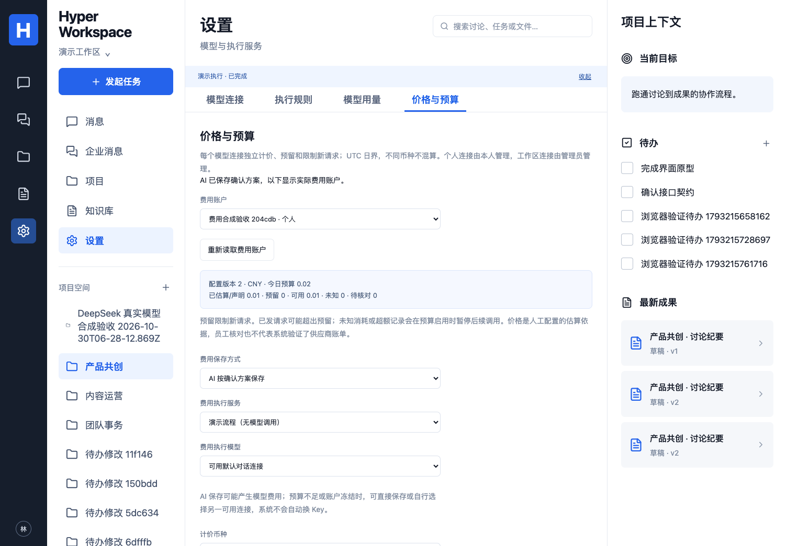

# 价格版本、请求预留与金额核对

映射：P04/P07/P08、C05/C07、A01/A10，E04/E07/E09/E10 子集。本模块实现**按模型连接**的计价及新请求预算检查；组织/项目跨连接总预算、自动获取价格/账单和正式企业验收仍未完成。

## 设置与权限

在“设置 → 价格与预算”选择模型连接。个人连接由所有者管理，工作区连接由当前管理员管理；普通成员能查看共享连接的当前价格/额度，但看不到他人的请求明细、计价依据和核对历史。价格以 CNY 或 USD 表示，不自动换汇。

输入普通输入、输出、缓存读写的每百万 token 单价、适用依据，以及可选每日预算和每请求预留金额。价格/预算最多六位小数，人工核对金额最多十二位小数。留空每日预算表示不启用本连接金额限制；显式 0 表示零预算。零单价也是明确的人工配置，不由缺失统计推断。不区分缓存价格时可填相同单价。

未配置价格的历史请求保持未定价，不按新价格回算。每次配置形成不可变版本，后续请求固定引用它。当天已有其他币种记录时拒绝切换计价币种；历史核对保留原币种。

人工保存和 AI 代保存共用服务。AI 仅执行员工已确认的 `ModelSpendingPlan`，提出一个 `spending.manage {}`，不能选择连接、币种、价格、金额或放宽预算。依据和核对说明留在后端，不放入模型上下文。AI 操作可能产生模型费用；额度不足时仍可直接保存或由员工另选连接，系统不自动换 Key。

[手机页面](images/model-spending-mobile.png)，均为合成连接及单价，不代表供应商价格或账单。

## 预算检查与停止行为

1. 每次供应商 POST 前，在产品事务中检查当前身份/连接权限、本连接 UTC 当日的已估算/声明金额及在途预留。两执行器、连接验证和 embedding 使用相同入口。
2. 当日未知费用、待核对超预留记录或混合币种阻止新请求。新预留加上已知金额和在途预留超过预算时，准入整笔回滚，不发出本次供应商请求。并发请求通过同一连接事务锁计算，不能重复占用旧余额。
3. 完整计数用请求开始时的价格版本估算并释放预留。用量、估算和事件原子保存；缺失缓存分类按可能的较高单价计算保守上界，不重复加入缓存或推理分项。
4. 未知/部分/无效用量和 HTTP 拒绝不自动视为免费，未结算预留保留；预算启用时暂停后续请求。发出后取消不能撤回供应商消耗。
5. 估算超过预留时保留超额和回执，暂停后续调用，等待有权员工核对。缩小预算只约束后续准入，不回滚已发请求。

**这里限制产品发起的新请求，不承诺供应商最终账单硬封顶。** 单价是员工声明，可能存在供应商未提供的分类/费用，已发请求也可能超出预留。页面区分价格估算、保守上界、员工声明和未知，不冒充已验证账单。

金额用 BigInt 和 PostgreSQL `numeric(40,0)`，单位 `10^-12` 货币单位；六位小数单价乘 token 整数可精确保留，不用浮点累积。不同币种分别汇总，每日归属按请求发起时的 UTC 日期；旧日未知记录仍保留，不假装纳入今日预算。

## 金额核对与审计

有权人员选择具体请求，填写非负金额、原币种和实际依据，并确认。显式零金额也需要依据。未结束请求不能立即核对；中断且未结算的记录至少等待五分钟。核对按版本和幂等回执执行，审计存储失败连同金额修改一起回滚。

员工声明可替代预算中的待核对金额并释放预留；原估算、用量、价格版本和声明历史仍保留。这不表示系统已查询或验证供应商账单。未知/待核对记录优先展示，近 30 天最多 100 条；最近 20 次变更可展开，完整记录保存在产品数据库。

工作区连接由管理员核对，普通使用者不能把公司费用归零。降权/失权后迟到读取不会返回原管理员的明细和依据；别人的个人连接也不会因工作区管理员身份而变成可管理。

## 接口与数据

- `GET /api/model-spending?modelProfileId=...`：指定可访问连接的当前账户及有权范围内记录；无参数最多 50 个近期连接，指定 ID 可访问更早连接。
- `POST /api/model-spending`：`{plan,idempotencyKey}`，plan 为确认过的 configure/reconcile，含预期版本；主体和权限由后端核验。
- AI 使用 `RunInput.workflow=manage_spending` 和 `spendingPlan`，模型参数必须为空；结果是私人回执，不发布到项目讨论。
- 价格、预算、声明分别保存于 `cw_model_price_versions`、`cw_model_spend_controls`、`cw_model_spend_actions`。请求保留价格/预算版本、估算、声明、预留及核对状态，Run、个人用量和 `usage.updated` 使用相同记录。

## 迁移与回退

`020_model_spending.sql` 新增价格/预算/审计表，扩展请求及 Run。沿用迁移角色和 `cw_` 运行权限重新授予流程，无新增服务或环境变量。未配置连接保持原有行为，历史未定价不补零。

回退前停止新的模型调用及自动派发，排空/停止在途请求并核对预留，保留价格、声明和回执再回退。旧版不认识金额预算，不能在回退后继续依赖新版预算闸门。

## 验证范围

新增 3 项精度/计价单元、8 项数据库和一个实际 HTTP 的预算/未知核对/AI 保存/手机场景。覆盖版本、并发预留、拒绝前不发 HTTP、未知/超额暂停、零金额、旧日、CAS/幂等、降权读写、审计回滚、伪造参数拒绝和说明不进模型。完整数据库 118 项、25 单元/配置、类型/构建通过。

3 个原生 DSH/Hermes/往返切换测试扩展配置、金额核对和预算拒绝；拒绝后合成供应商 HTTP 数不增加。测试使用合成价格/声明，不代表实际价格或公司账单验收。截图已检查；Browser plugin not available，使用 Playwright Chromium，桌面 1504×1045/手机 390×844，Safari/Firefox 未测。完整 40 项 UI 与本轮 CI 结果见 [实现记录](IMPLEMENTATION.md)。

首轮证据保留：保存方式下拉框改为按可访问名称定位；旧用量测试适配人工价格/声明状态；方法准备在 20 秒边界内观察真实队列终态；RPC 先等待子进程 ready，之后仍使用原 300ms 响应超时。首轮 24/25 单元、38/40 UI 未计为通过，修正结果单列。
