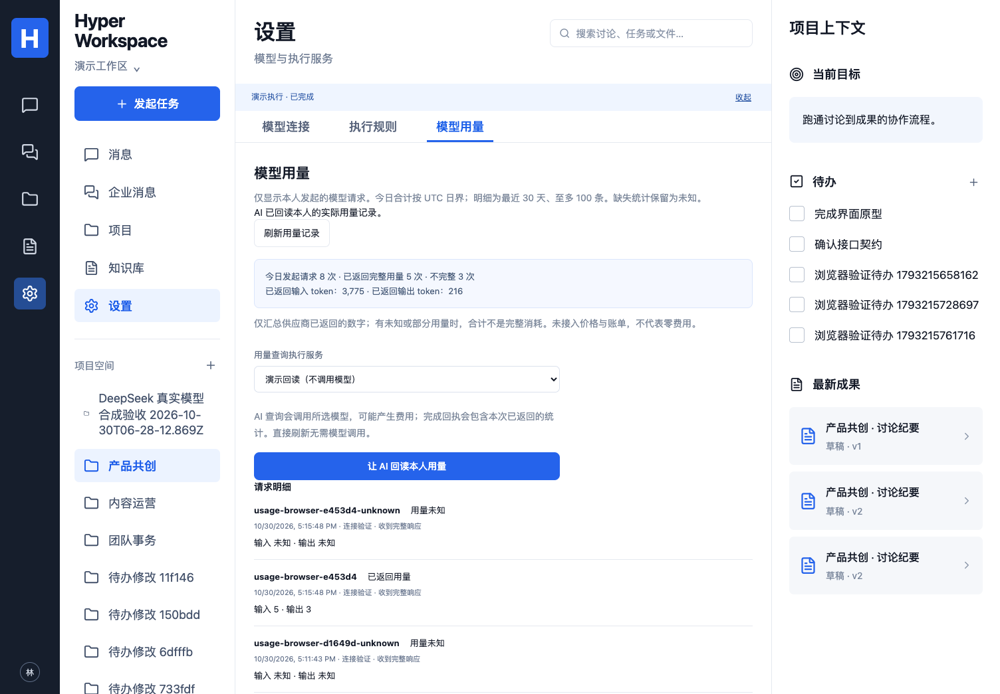

# 模型请求与用量记录

映射：P04/P07/P08、C02/C05/C07、A10，E07/E09/E10 子集。用量来自实际 HTTP 响应，不采用执行器界面可能补零的统计；供应商报告仍不等同于最终账单。

## 使用与口径

“设置 → 模型用量”展示本人今日发起的模型请求、已返回用量、不完整记录，以及最近 30 天至多 100 条明细。直接刷新无需模型；“让 AI 回读本人用量”使用所选引擎/模型，可能产生一次或多次实际请求，完成回执包含查询本身已经返回的统计。演示流程只验证回读服务，不调用模型。

后台按当前身份固定查询范围。工作区管理员在此入口同样只读取自己发起的调用；不能通过模型参数选择他人、费用或收件人。AI 仅提出一个 `usage.report {}`，产品重新回读账目并保存私人 Run 回执，不把模型自由生成的金额或结论发布到项目讨论。

“执行规则”的每日次数仍是获准 Run 数，与这里的 HTTP 请求数分开。一条 Run 可能发生多个请求；连接验证、向量索引和检索 embedding 也分别记录。发起记录在网络调用前保存，网络错误不能证明供应商没有收到请求。

| 用量状态   | 含义                                                             |
| ---------- | ---------------------------------------------------------------- |
| 已返回用量 | 供应商明确返回所需输入/输出计数；embedding 不伪造输出 0          |
| 部分用量   | 只收到部分字段或流式响应未正常结束，已观察数字保留但不是完整消耗 |
| 用量未知   | 未返回可用统计、HTTP 拒绝、断网或尚未完成记录；不自动计为零费用  |
| 统计无效   | 负数、字符串、非安全整数或总量/分项矛盾；不拿错误统计计算消耗    |

已返回数字可汇总，但有部分或未知请求时不是完整总消耗。没有观察到的历史调用不补记为零。后续[价格与预算模块](MODEL-SPENDING.md)已接通人工价格版本、币种、缓存单价、金额估算和按连接的请求预留。未配置价格的请求仍标未定价，未知统计不补零；员工金额声明与估算分别显示，不代表供应商已确认账单。跨连接组织/项目预算和自动账单对账仍未实现。

[手机界面](images/model-usage-mobile.png)，均为合成测试资料。

## 后端链路

两个原生执行器使用 Worker 内每 Run 独立的 loopback 网关，只取得本次短期凭据和模型路由，真实供应商 Key 留在产品后端。网关不对外发布端口，关闭后短期凭据失效；不新增部署服务。只接受绑定模型的 Chat Completions/Messages 请求，拒绝原生工具、其他模型、未授权路径与凭据；输出上限由当前有效规则再次约束。每次请求前重新检查 Run、身份与来源范围。

请求入账后才发出网络请求；流式字节原样转发，同时在有界临时内存中只提取允许的数字字段。OpenAI 兼容接口按 aggregate prompt/output 计数，缓存命中及推理 token 是分项，不能重复相加。Anthropic 合并累计更新，输入加上明确报告的缓存读写字段；缺失必要字段时保留为部分未知。不同接口不支持的字段保持 null。

完成计数与 `usage.updated(kind=provider-response)` 在同一事务保存，并通过请求 ID 幂等结算。取消、断流、角色撤销或存储失败保留发起记录；没有结算成功的行继续显示未知。停止请求不能撤销已发生的供应商消耗。Run 查询也提供发起人可见的 `modelUsage` 汇总。

直接连接验证/embedding 共用同一计数规则。表中只保存主体、模型连接、声明模型/provider、Run 引用、时间、HTTP 状态及允许的 token 数字，不保存 Key、endpoint、提示词、文件/聊天正文或原始响应。私人文件被撤回后保留不含正文的执行用量，仍不能绕过原 Run 的来源权限读取内容。

API：`GET /api/model-usage`；固定当前员工，最近 30 天/100 条明细及今日 UTC 汇总。AI 工作类型 `usage_report` 经相同个人用量服务查询，不接受模型选择主体/时段/价格。此版本未提供向其他员工发送账目或组织财务汇总的入口。

## 迁移与回退

`019_model_usage.sql` 增加 `cw_model_requests`。按部署迁移流程使用迁移角色执行并重新授予运行角色 `cw_` 表权限；无需新增环境变量或外部端口。旧 Run 没有观察记录时保持未知，不重算历史。

回退前停止新派发，排空/停止并核对运行中请求及 `usage_report` Run；保留用量表和回执，再部署旧版。不要通过删除未知行或补零来消除待核对消耗。

## 验证与边界

本地 22 项单元/配置、完整 110 项数据库回归通过（含 6 项用量测试及结算事件存储失败/事务回滚）。3 项真实 DSH/Hermes/往返切换用合成 HTTP 服务验证请求用量、Key 隔离及本人的 AI 回读，全部通过。新增桌面/手机场景通过，覆盖实际测试 endpoint 返回完整/缺失统计、AI 回读及失权后的迟到响应清理；固定代码后的完整 39 项界面回归全部通过，用量实现 `bb2fde8422f732494719b609979bf010aa5c44a8` 的 [CI 41033005171](https://github.com/MkaliezZ/hyper-workspace/actions/runs/41033005171) 三个 job 全部成功，198 项首轮通过：22 单元/配置、3 下载器、8 解析、110 数据库、3 原生执行器、39 UI、9 真实来源、4 容器；另含类型、构建、两个 npm 审计与冻结包。

本机还使用已配置的实际 `deepseek-flash` 连接，在 DSH 和 Hermes 下各执行一次个人用量回读；两个 Run 均成功、runtime 证据、各观察到一条供应商请求，输入/输出统计完整结算。只使用合成项目和本人的用量数字，没有公司资料或费用结论；私人脚本及原始报告保存在忽略且受限的运行目录，不进入公库。本次小样例不能替代多模型、真实 embedding 质量或正式企业验收。

首轮完整 UI 回归为 38 通过/1 失败：旧方法场景在开发服务重启时工作区响应被截断，trace 显示原始 JSON 读取失败，进程启动时间与代码更新重合；未当作通过。固定代码后重跑完整回归，39 项全部通过；记录保留在 [实现记录](IMPLEMENTATION.md)。Browser plugin not available，使用项目 Playwright Chromium，桌面 1504×1045/手机 390×844；Safari/Firefox 未测。

协议依据：[DeepSeek usage 与流式响应](https://api-docs.deepseek.com/api/create-chat-completion/)、[Anthropic 累计流式 usage](https://platform.claude.com/docs/en/build-with-claude/streaming)。核查于 2026-10-30；不据此固定供应商模型版本、价格或账单正确性。
