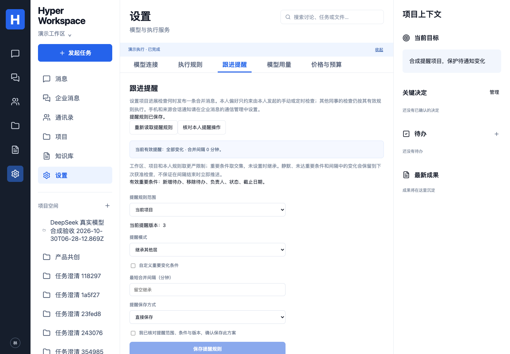

# 跟进提醒规则与个人偏好

对应 P03/P04/P07/P08、C00/C05/C07、A01/A02/A06/A10，以及 E03/E04/E09/E10 的行为子集。原三层定义、执行器和冻结交接包不变。

## 功能和完成标准

在“设置 → 跟进提醒”读取当前项目的工作区、项目和本人规则。人工和 `manage_notifications / notifications.manage` 使用同一个 `NotificationPolicyService`；DSH、Hermes 均声明该能力。一次 AI 操作只允许一个空参数工具，范围、版本、条件由员工确认并由服务端绑定。

此模块控制进展检查在**产品项目讨论中**发布的合并消息。它不改变源 Talk 的手机通知、接收设备或会话级提醒；那些设置属于通信管理。个人偏好只约束该员工发起的手动或定时检查，不代表禁止其他员工的检查或静音其客户端。

共享规则由当前产品管理员修改；普通成员只能修改本人偏好。所有读取、配置、执行和回执回读仍需产品成员身份与当前来源项目权限。产品管理员不能绕过源会话成员资格。

完成以实际规则版本、动作回执和消息 ID 为准，模型文字不证明设置或投递成功。设置与回读的 AI 结果仅对发起人开放，不向项目广播。

## 规则组合

| 字段                 | 值与范围                                         | 生效方式                                                 |
| -------------------- | ------------------------------------------------ | -------------------------------------------------------- |
| `mode`               | `all / important / quiet`，可省略                | 工作区、项目、本人取更严：quiet > important > all        |
| `importantFields`    | 新增、移除、标题、负责人、状态、截止日期；不重复 | 显式配置的集合取交集；省略继承，空集合表示无重要触发条件 |
| `minIntervalMinutes` | 0–1440 整数，可省略                              | 各层取最大间隔；按上次实际发布时刻计时                   |

没有配置时保持已有行为：全部当前变化、零间隔。默认重要字段是新增、移除、负责人、状态、截止日期；标题变化默认不触发“仅重要变化”。员工 ID 变化也算负责人变化。

`important` 判断的是**发布触发条件**：只要当前差异中有一项满足条件，就把同次其他尚未通知的差异合入一条事实消息。模型不判断重要性、不选择接收者，也不选择另一员工的偏好。

初次检查建立基线且不发布。无变化保持静默。静默、仅次要变化、合并间隔内的检查只更新检查时间，**不推进公共比较快照和基线 Run**；因此静默员工不能让其他符合条件的员工漏掉待通知变化。下次获准的手动或定时检查重新比较当前状态后决定是否合并发布。

本模块不增设自动任务、不额外调用模型，也不保证间隔到期立即发送。它比较当前事实与上次基线，不是所有瞬时状态变化的事件投递系统；已恢复到原值的中间变化仍保留在业务版本历史，未承诺逐次提醒。

## API 和执行边界

- `GET /projects/:id/notification-policy`：返回当前三层规则、有效配置、当前共享管理权限，以及本人在当前项目/工作区/个人范围最近 20 条设置回执、当前项目最近 20 条提醒 Run。不能读取他人个人偏好或其他项目的配置历史。
- `POST /projects/:id/notification-policy`：严格 `{plan,idempotencyKey}`。配置 plan 为 `{operation:"configure",scope,expectedRevision,rules,confirmed:true}`；回读 plan 为 `{operation:"read"}`。不接受自报 actor 或 scopeId。
- `POST /runs`：`workflow:"manage_notifications"`，显式 `notificationPlan`、当前项目会话、执行器和模型配置引用。不能混入成果、成员或其他业务目标。
- 模型上下文只包含操作类型及执行契约，不包含规则值、项目讨论、待办内容或个人偏好。模型工具必须是空参数；工具执行前再核对当前权限与规则版本。
- 提醒配置受同一执行 Policy、工具范围、模型用量和费用控制。回读/配置运行的进度、错误和结果均采用产品事件与实际回执，私有运行目录在结束及恢复处理中清理。

配置具有乐观版本锁；两个并发修改只有一个能写入同一版本。规则更新和审计回执处于同一短事务，失败一并回滚。锁顺序为工作区执行 Policy → 提醒规则 → Run/目标 → 成员；来源 HTTP 和模型工作不持有数据库事务。

## 幂等、失败和恢复

同一员工请求键绑定完整 plan 和后端解析的范围。已成功请求重试返回原回执，后续版本变化或管理员降级不会重做旧操作；同键换参拒绝。AI 入队重试也先查找原 Run，不以旧 expectedRevision 新建第二个执行。当前成员和源范围仍必须有效。

前端在缺少写入回执时冻结完整原请求，包括版本、方式、执行器、模型和请求键；页面内重试使用原请求，不允许一边改方案一边重试。409 要重新读取并确认新方案；401/403/404 清空私有视图。读取使用取消和代次校验，旧响应不能恢复失效配置。“核对本人提醒操作”按原请求键查找已保存设置或已入队 Run，找到后回读并接回原执行，不再提交第二次请求。切换页面后也能从本人最近执行找回已入队任务。历史读取不把未保存编辑自动套到新规则版本；最近 20 条未找到不证明失败，不应盲目换键。

发布消息、公共跟进快照和动作回执原子提交。已发布后执行被中断仍保留消息与动作事实，执行进入既有恢复流程，不宣称取消能撤回消息。共享消息只保留消息 ID、差异摘要等投递依据，不包含发起人的个人偏好层。

## 数据与迁移

迁移 `039_notification_policies.sql` 新增三层当前规则、不可变配置变更记录、Run 确认方案，以及公共基线的 `last_notification_at`。旧数据仅从真实已有 `follow_up.check` 产品消息恢复上次发布时间，检查时间不冒充发布时间。迁移 `040_notification_run_history.sql` 为本人当前项目的执行找回增加局部索引，不改变权限或既有 Run。配置源 Run、主体、版本和审计记录由产品保存，向量索引与执行器私有目录不拥有规则。

已有库先备份并运行 `npm run migrate`。回退代码前停止并核对此类活动 Run；旧版不理解新的工作类型。保留规则、回执和发布时间，不删除审计或忽略来源检查来回退。需要完整回退时使用经过验证的迁移前数据库备份与对应旧版本组合；不要在有新审计事实的库中直接 DROP 表。

## 当前验证边界

- 本地 13 项新数据库用例和 6 项既有跟进用例通过；覆盖共享收紧、个人隔离、版本与并发、静默不吞公共变化、重要触发合并、间隔、模型期间规则变化、源撤权、AI 参数拒绝、私有回执与原 Run 重试。
- 一项新增原生 DSH/Hermes 联合测试通过，5 次模型协议请求，来源 HTTP 为合成服务；验证本人静默后同事只发布一条消息，无来源 Talk 写入。真实执行器不等于真实供应商或公司模型质量。
- 6 项新增 UI 用例通过，含直接/AI 保存与回读、继承、未知回执原键重试、冲突重读、撤权迟到响应、普通成员限制和手机溢出检查。首轮 5 项失败已保留：下拉标签包含选项文本，另有测试错误假定 StrictMode 只发起一次读取；增加明确标签并按实际请求阶段控制迟到响应后原行为断言通过，未跳过或放宽权限断言。
- 主实现 `a4857a34a5a7726ad5d79ab78a5cef86078a4c00` 的 [CI 41300542152](https://github.com/MkaliezZ/hyper-workspace/actions/runs/41300542152) 三个任务全部成功，新增真实 Nextcloud 联合用例和容器持久化/真实发布后重启断言通过；本机无 Docker，来源/容器证据来自该 CI。随后补原任务找回与布局，其最终代码提交按自己的 CI 核对。完整本地回归在主实现上 39 单元、226 数据库、7 原生、69 UI 通过；之后补私有 Run 找回与复选框布局，新增数据库第 13 项与 6 项模块 UI、类型/构建通过，最终 CI 另记。Browser plugin 不可用，使用仓库 Playwright Chromium；桌面 1504×1045、手机 390×844 截图已视觉核对。

2026-11-01 本机另用已配置的真实 DeepSeek Flash 完成 DSH 项目提醒配置、Hermes 私有规则回读各一次：Run `a6b6c195-6b67-450f-a0cf-beaec02ea6b4`、`618a22d3-8bec-453b-94bc-b3ce49e59158` 均为 runtime/succeeded，各 1 次 HTTP 200/completed 且供应商返回用量（2525/97、3212/33 input/output token）。配置重要状态变化、15 分钟间隔后有效值回读一致，无模型自选参数；来源为本机合成 HTTP 服务，0 次来源写入。未向公司发送消息或修改本人/工作区提醒。临时来源和凭据已停用/清空；实际模型 Key 沿用既有产品连接，不复制到测试库、报告或仓库。费用保持 unpriced，不把调用次数/token 或官方报价冒充账单。

调用前核对了 [DeepSeek 官方模型与价格页](https://api-docs.deepseek.com/quick_start/pricing/)，通过正常产品模型网关及现有 Policy/费用控制执行；未改价格、预算或放宽限制。报告和脚本仅在被忽略的受限 `.runtime` 中，公开文档保留上述最小元数据。

完整 E01–E10、公司环境真实提醒质量及人工 E08 评分仍待验收；跨连接组织/项目金额预算、备份恢复演练及生产部署等交付项仍独立保留。

[手机界面](images/notification-policy-mobile.png)。
