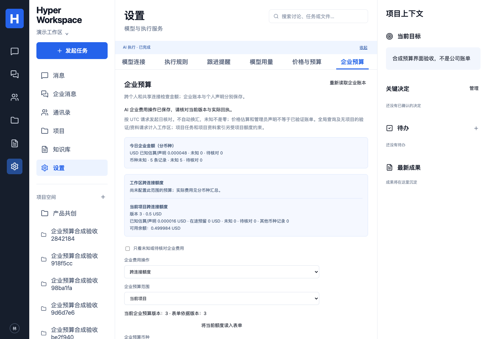

# 企业计价与跨连接金额预算

映射：P04/P07/P08、C05/C07、A01/A10、E04/E07/E09/E10 子集。状态：已接入当前开发批次，完整来源/容器及本代码 CI 结果单独记录；不修改冻结三层、首版范围或正式验收状态。

## 操作与权限

“设置 → 企业预算”提供企业计价依据、整个工作区/当前项目的每日额度，以及针对确切请求的企业金额声明。当前工作区管理员管理企业口径；普通员工不能修改这些规则或读取企业私有计价说明。项目额度另需当前源会话访问权限，产品管理员不因此获得原件、消息、成果或其他员工私人 Run 的访问权。

企业金额记录是产品拥有的独立财务元数据。当前管理员可核对本工作区所有连接的企业金额，包括来源已删除的历史费用；不返回其他员工的个人连接 ID/名称、私人单价/发票、来源正文或其他项目 ID。当前有权项目的 ID 可显示，其余只标记“其他项目企业金额”。这项财务权限不会使来源项目重新可读，也不能代替 Source/ProjectAccess。

个人连接费用仍在“价格与预算”管理。企业口径不信任员工自行设置的零单价、私人声明或未知费用清除；企业声明也不改变私人账目。供应商用量只记录一次，两个成本口径引用同一请求，并非又发出一次请求或认定两张真实账单。

每次修改需要明确范围、币种、金额、预期版本和员工确认。人工保存及 DSH/Hermes 的 `manage_spending → spending.manage {}` 共用服务；模型不能选择或更改主体、价格、金额、币种、范围，也不能声称已验证发票。企业计价/核对依据不进入模型上下文，财务操作的回执不发布到项目讨论。

## 独立企业计价

管理员按确切的 provider、规范模型 endpoint、model、chat/embedding 用途声明单价，形成不可变历史版本；普通输入、输出、缓存读写分别计价。地址不能含 URL 凭据、查询或片段，Key 仍只在原模型连接加密保存。

每百万 token 单价最多六位小数，金额用 BigInt / PostgreSQL numeric(40,0)，内部单位为 10^-12；管理员声明最多十二位小数。不用浮点累计，不自动获取或猜测供应商单价，不自动换汇。明确零单价是管理员声明，不从缺失用量推断免费。

同一请求固定使用准入时的企业价格版本。新价格不回算旧账；旧个人估算不自动成为企业估算。迁移时历史请求在新账本中保持未定价，包含当天记录；启用预算不能静默遗漏历史未知。

目录首屏最多 100 条，按确切模型读取可以取得未显示的旧条目及当前版本。请求记录按近 30 天每页 100 条展示，支持读取更早页、只看未知/待核对和确切请求查询。分页保留原 PostgreSQL 时间精度，避免同一毫秒内的请求被跳过。

## 新请求的准入与结算

每次真实供应商 POST 前，产品在同一事务检查当前身份/凭据、个人连接限制以及适用的工作区和项目金额限制；失败整笔回滚，不留下半份预留，也不发本次供应商请求。先取工作区锁，再取模型连接及相关行锁，两条连接不能同时占用同一笔旧余额。

- 工作区覆盖其全部个人/共享连接，包括 chat、embedding 和连接验证。
- 项目归属从已保存 Run/会话取得，不信任模型 body。已知项目的资料索引按项目拆分批次，在主机验证过的范围下计入对应项目；无项目的私人资料和全局查询计入工作区，不虚构项目归属。
- 工作区与项目额度同时适用；币种必须与该请求的管理员价格一致。当前日按请求开始时的 UTC 日期归属。
- 已知金额、在途预留与本次预留超过上限，或者存在未知/待核对/其他币种金额时，暂停该范围的新请求。零预算不等于“未启用”；留空额度才是不启用。
- 完整计数按原价格版本估算；缺失缓存分类采用保守上界。取消、HTTP 拒绝、部分/无效/缺失统计均不视为免费，未结算预留及原用量保留。
- 估算超出预留会保存超额事实、标记待核对并暂停后续调用。缩小规则不回滚已发请求；管理员可明确关闭限制，混合币种和未知记录仍保留，不转换或删账。

单个范围采用一种预算币种。当日存在其他币种企业金额时，不能启用或切换为混算；可以明确关闭规则，分别显示金额，并核对后续的企业计价口径。页面不把默认表单币种下的零值当成全部企业费用，汇总按币种分别列出，未知币种单列。

这里限制产品发起的新请求，**不承诺供应商最终账单硬封顶**。价格与金额均为管理员声明/估算，供应商可能有未提供的费用分类；已发请求也可能超过预留。原估算、声明、用量、价格版本和审计一起保留，不把声明当成自动查证过的发票。

批量索引可能先完成一个项目的模型批次，再被另一项目额度阻止。此时明确报告已经完成的模型批次及未提交的新向量，不暗示此前消耗回滚；请核对模型用量和实际索引结果。每一个新批次仍需单独通过准入。

## 金额声明、冲突与恢复

管理员选择确切请求、原币种、非负金额和实际依据进行声明。未结束请求至少等待五分钟再核对；未定价且原币种未知的历史记录由管理员明确声明币种。并发修改用版本校验，原幂等键只找回原回执；不同输入或跨个人/企业费用操作复用同键会冲突。审计保存失败则相关变更回滚。

页面把当前记录与表单依据版本分开。重新读取列表/历史不会悄悄改变未保存草稿的目标版本；需明确读入当前额度或读取确切计价，才替换表单。权限丢失后清除私有表单/明细，旧读取迟到也不能恢复。AI 自身也会计费，当前额度不足时可直接管理规则；系统不自动换 Key。

迁移 041 新增企业价格版本、控制、费用和操作记录；无新增服务、依赖或主密钥。升级按部署文档停止旧版 API/Worker、备份、迁移并重新授予运行角色 DML，再启动相同代码版本。旧代码没有企业预算闸门，不能在回退后继续依赖它强制公司额度。

[备份/隔离恢复](BACKUP-RESTORE.md) 保留新账本及所有金额版本。恢复库未结束、未声明的供应商请求和企业费用标为待核对，预留/用量不抹零、不重放；需核对后才按有效预算继续。原库不变，恢复检查不自动启动服务或切生产。当前工具需要完整 041 迁移集；旧归档先使用其匹配版本隔离恢复，再按升级流程迁移。

[手机界面](images/organization-budget-mobile.png)。

## 验证证据与边界

当前本地：15 项预算数据库/HTTP 用例已通过，覆盖不同连接并发、个人零单价与声明隔离、工作区/项目交集、embedding/连接验证、旧价/明确零/未知/超预留、角色与凭据撤销、确定分页、精确计价读取、CAS/幂等/审计回滚及来源删除后的独立财务权限。包含混币种规则明确关闭；最新完整数据库回归 245/245，类型检查、48 单元与生产构建通过（仍有既有单包大于 500 kB 的构建提醒）。扩展的 3 项真 PG 备份测试通过，保留未知预留与原估算/声明且恢复后阻止新准入。

双原生联合场景已通过：DSH/Hermes 共用账本，模型不能伪造金额，执行中降权不能写入规则；计价说明/声明依据不入模型。完整 9 原生曾通过，最终准入降权保护后的定向原生复测也已通过（6 次测试 HTTP，0 次实际供应商调用）。模型/金额/身份均为明确的协议测试资料，本批未调用真实供应商，不冒称真实账单质量验收。

首轮完整数据库为 238/241（本机 PG 工具目录未传入）、随后 240/241（现有维护人移交同键重试遇到提交前后竞态）。补正确工具路径，保留原断言；方法服务在准备失败时于当前项目权限下核对自己的同键已完成回执，并增加确定调度，10 项方法回归通过，完整 241 项随后通过。新索引用例首轮缺少项目会话、分页用例把未结束请求当成可即时声明，分别修正合成资料而保留权限/等待要求。记录均保留，没有跳过用例或把失败轮计为全过。

界面首轮 0/2：包裹 select 的 label 在精确定位时不匹配；增加明确可访问名称后，直接保存/原生 AI/预算拒绝/草稿版本/失权与迟到响应两场景通过。视觉核对后调整为既有设置布局，并分币种显示，2 项再次通过。Browser plugin not available，使用项目 Playwright Chromium；桌面 1504×1045、手机 390×844。最新完整 UI 在独立 5184 环境首轮发现旧测试固定 5173 的 URL/Origin 与隔离部署不符，已停止并保留记录；仅在私有测试副本替换端口、保持原断言，再跑 72 项。最终结果与本批真实 Nextcloud/Compose CI 单列，不借用旧提交的绿色结果。本机无 Docker；来源/容器场景目前只完成加载清单（15/6），不能计作行为验收。

正式供应商金额/账单、公司实际使用、其他剩余功能和完整 E01–E10 未完成。用户对两份真实模型 v2 纪要“结果、状态、负责人、下一步清楚”的反馈已记录于 [业务报告](REAL-BUSINESS-ACCEPTANCE.md)，仅覆盖该项清晰度，不等于完整 E08 或产品验收。
