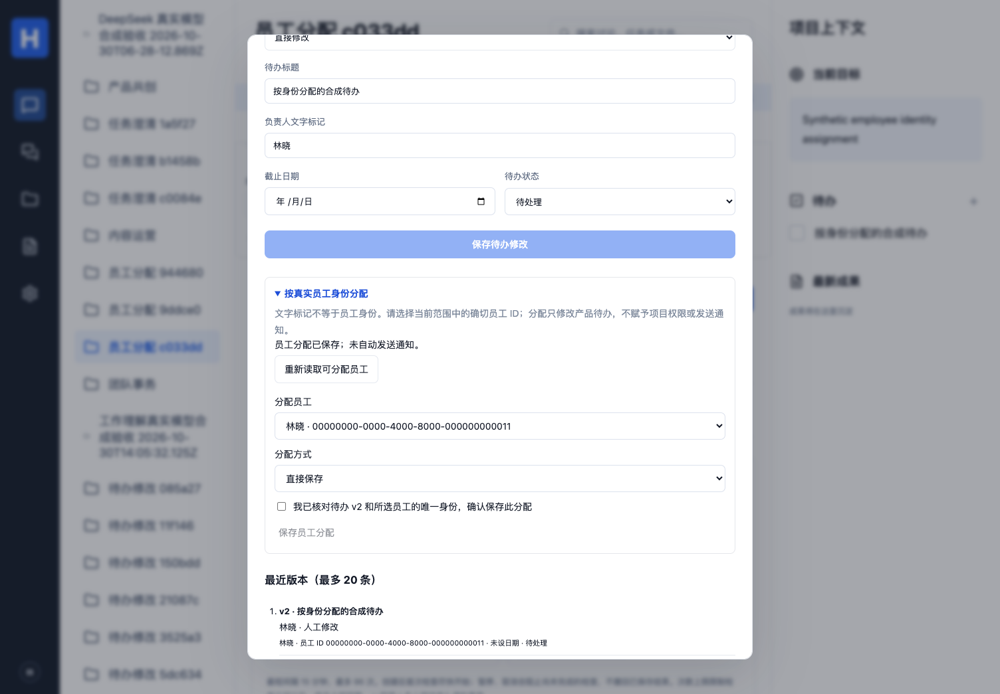

# 项目成员目录与真实员工分配

映射：P02/P04/P07/P08；C00/C03/C05/C07；A01/A02/A06/A10；E01/E02/E04/E07/E09/E10 子集。固定技术、三层定义、DSH 默认与 Hermes 兼容保持不变。

## 当前范围

任务页“项目成员与真实身份”按当前权限读取目录，可按姓名、来源 UID 或产品员工 ID 筛选。同名人员分别显示唯一 ID，不用同名、近似度或历史文字标记推断身份。

- 来源关联项目：用当前员工凭据读取当前 Talk 会话参与者，仅接收普通用户身份与已支持的永久成员角色。按 provider/workspace/remote UID 精确对应已登录、当前仍有工作区权限的产品员工。
- 未关联来源的项目：列出当前工作区成员；这是产品成员目录，不冒称已同步完整企业通讯录。
- 来源内尚未对应产品员工、或已失去工作区权限的人显示为不可分配。不会自动建号、邀请、恢复成员资格或授予角色。访客、邮箱、组等不会被当成同名员工。
- 最多 2000 项；超过范围、格式异常、重复源身份或来源不可确认时拒绝使用，不用旧缓存补授权。没有承诺大组织完整分页、部门树或全公司身份同步。

来源依据：[Talk 参与者接口](https://nextcloud-talk.readthedocs.io/en/latest/participant/)，核对于 2026-10-30。实际实现只处理固定兼容版本验证过的字段；不读取来源数据库。

## 分配与人工接管

创建待办时的负责人文字仍是标记。进入“修改待办 → 按真实员工身份分配”，选择当前范围中明确的员工 ID，并确认所见待办版本；可直接保存或由 AI 按同一确认计划代保存。绑定后旧文字字段不能改写人员身份，改派必须继续走此入口。清除绑定也需要明确选择与确认。

分配只更新产品待办，保留分配时显示名、稳定员工 ID、版本及来源映射依据。名称变化不更换身份；人员离开工作区/来源后，历史分配和版本仍可核对，新分配必须重新通过当前范围检查。历史关联不授予项目访问权，也不阻止管理员撤销成员资格。

人工与 AI 共用 `TaskAssignmentService`。模型只提出一个 `task.assign {}`；具体待办、版本、员工 ID/清除决定由主机绑定，模型不能按名字另选目标、创建身份、授予权限或宣称已发通知。分配不自动给员工发消息；既有获准跟进可比较身份变化并报告产品状态。

旧记录不按姓名自动回填 ID。新增版本保存当前绑定状态，旧快照没有记录 ID 时保持未知。两个同名员工之间的改派会按 ID 记录为真实变化，下一次无变化跟进保持静默。

## AI 目录读取与权限

“AI 读取项目成员”使用 `directory_report / directory.read {}`，与人工目录使用同一服务。模型只接收主机固定的读取要求，不先取得整份人员目录来决定过滤或授权；工具回执保存当前范围、核验时间和实际读取行。回执属于发起人的 Run，不自动发布到项目讨论。

目录及员工分配都先验证当前项目/来源权限。模型工作完成后，分配动作前再次读取目标的当前来源资格；事务内核验工作区成员、源身份映射、来源绑定及任务版本。原子保存任务、历史、实际回执和审计；版本冲突拒绝覆盖，幂等重放原结果，审计失败整笔回滚。

来源接口与产品 PostgreSQL 不是同一事务：源成员关系可能在远端检查之后再次变化，本版本不承诺跨系统原子提交。分配不扩大读取权限；后续操作继续核验当前来源，既有历史不冒充现时成员资格。

拒绝读取后页面清理目录、模型选项和搜索词，并通知同项目的其他已挂载目录视图清理；迟到响应不能恢复旧名单。离开项目/关闭页面后不会将旧响应放入新上下文。

## 接口与数据

- `GET /api/projects/:id/directory`：当前可读范围，真实 ID 或不可分配状态、核验时间及范围说明。
- `POST /api/tasks/:id/assignment`：`{plan,idempotencyKey}`，plan 包含匹配 URL 的 taskId、expectedVersion、assigneeId（清除用 null）、confirmed=true。
- AI：`RunInput.workflow=assign_task`、相同 `taskAssignmentPlan`，只接收一个空参数 `task.assign`。读取目录为 `directory_report`。
- `cw_tasks.assignee_id` 关联稳定产品员工；版本保存绑定状态；`cw_task_assignment_actions` 保存实际依据、来源 Run 和幂等回执。成员撤销不删除历史身份，也不会因为任务关联而复活权限。

## 部署、回退与证据

迁移 `022_task_assignment.sql` 增加员工关联、分配审计及 Run 计划列；沿用迁移角色和 cw\_ 表权限授权，无新依赖或服务。原始冻结快照保持可校验。

回退前停止新派发并排空/停止、核对 assign_task 和 directory_report；保留分配字段、历史和审计。旧 Worker 不认识新工具，旧任务编辑接口也不能被当作具备新版身份保护；回退后不要继续依赖新版身份闸门或直接改写已绑定人员的文字字段。

本机 25 单元/配置、完整 132 数据库、类型/构建通过；新增 8 个身份/分配场景，覆盖同名、源 UID、未知/访客、撤权/失权、模型伪造、CAS/并发、审计回滚与同名改派跟进。新增业务浏览器场景及扩展的原生 DSH 读取 → Hermes 分配 → DSH 清除通过，协议模型与真实模型分别记录。完整 42 项界面回归也已通过，当前实现 `7de26bb353dc2c267644784e38f673bd13322ac0` 的 [CI 41075340989](https://github.com/MkaliezZ/hyper-workspace/actions/runs/41075340989) 三个 job 全部成功，227 项首轮通过：25 单元/配置、3 下载器、8 解析、132 数据库、4 原生执行器、42 UI、9 真实来源、4 容器；另含类型、构建、两个 npm 审计与冻结包。CI 使用合成账号/资料和协议模型，不等于公司全量验收。

Browser plugin not available，使用项目 Playwright Chromium；桌面 1504×1045/手机 390×844 检查页面身份、内容、overlay、控制台、实际保存/历史、移动布局和失权迟到响应。Safari/Firefox、正式公司通讯录及员工验收未测。Linux 真实 Nextcloud 身份映射/分配、来源撤权拒绝，以及受限容器重启保留绑定/版本/来源 Run 已在本次 CI 实测通过；本机没有 Docker。

这实现明确选择后的真实 ID 绑定与项目目录，不表示已完成全组织通讯录、自然语言负责人自动消歧、讨论中自动绑定所有人、完整组织协作或 E01–E10 正式验收。

[手机分配界面](images/task-assignment-mobile.png)。全部为合成资料；截图已逐一查看，控件与历史可滚动访问，无横向溢出。

实际 DeepSeek Flash 的 DSH 目录读取和 Hermes 明确 ID 分配两个小样例均通过；每次有一条完整结算的供应商请求。人工清除后保留已分配的身份历史。使用演示员工和合成待办，未连接公司真实通讯录，见 [实际模型记录](REAL-MODEL-SMOKE.md)。

首轮 [CI 41074283284](https://github.com/MkaliezZ/hyper-workspace/actions/runs/41074283284) 的容器场景为 3 通过/1 失败：新增明确员工分配增加一次实际模型请求，旧精确断言 8 次未同步为 9 次。分配与重启后的历史检查已经执行通过，但该 job 不计为通过。修复保留精确 9 次与零违规要求，修复提交的完整 CI 结果见上文，不将首轮失败计为通过。
