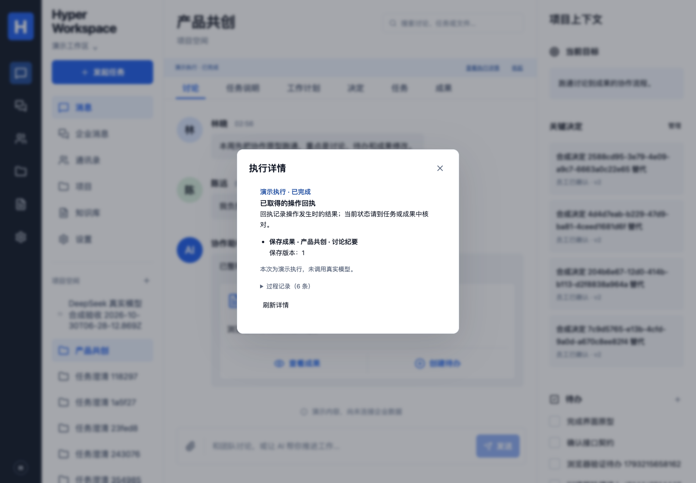

# 执行详情、回执与过程记录

2026-11-03。对应 P04/P07/P08、C05、A09/A10、E04/E08/E10，固定三层和首版范围不变。本批核对发现此前界面只有执行状态条，未提供文档所称的按需日志入口；本批补齐该入口，不能用旧文档表述证明先前已经完成。

## 员工使用

当前任务的状态条提供“查看执行详情”。打开后重新核对当前员工对该 Run 和来源的访问权限，展示实际回执、保存版本、负责人、截止日期及已记录状态。回执反映操作发生时的结果，当前任务/成果仍须到对应业务对象核对；失败、停止和未知结果不被包装为自动回滚。

过程记录默认折叠，展开后展示按序的时间和业务事件，超过一页可继续加载。页面不会输出原始模型提示、推理过程、请求头、密钥或执行器文件。只在主动打开详情后读取记录，关闭或切换主体/项目后取消读取。详情打开期间对活动 Run 做有界串行状态检查；历史记录按本次读取展示，点击“刷新详情”可重新核对。权限失效、退出或来源暂时无法核验时，旧回执与记录清除，显示失败原因。

终态结果和过程事件中的同一回执按一一对应合并；不会因为两次实际操作的结果完全相同而合并掉其中一次。未取得回执会明确说明“不代表一定没有发生操作”，不提供盲目重放入口。模型用量不完整和费用未配置保留为未知，演示执行明确标记未调用真实模型。

来源工作区的十秒刷新增加未完成请求保护。慢读取期间不继续叠加同类请求，完成后恢复检查；没有增加权限缓存、放宽来源检查或改变模型执行时限。

## API 与权限

- `GET /api/runs/:id/history?after=0`：仅当前 Run 主体可读，继承 `getRun` 的工作区、当前来源及私人资料检查；通信管理继续使用已有公开元数据过滤。
- 每页最多 100 条，返回 `{events, after, hasMore}`；查询至多取 101 条判断下一页。游标须为非负安全整数，记录按 sequence 递增。
- 既有 `/api/runs/:id/events` 保持 SSE，JSON 历史使用独立端点；未把流式响应当 JSON 解析，也未改变原生执行器或工具协议。
- 没有数据库迁移。回退到先前应用版本后保留全部既有 Run、版本、事件和动作。

## 已做验证与边界

慢请求回归在修正前复现刷新重叠，修正后通过。两项浏览器场景验证按需读取、折叠/展开、390px 手机布局和真实退出后清除旧回执；25 项数据库/执行规则检查通过，包含事件分页及其他员工/工作区不能读取；2 项回执合并单元检查保留失败 Run 中两次相同真实动作，避免漏报。既有 63 单元、类型和构建已通过；新代码完整 CI 另查其对应提交。首次界面检查中使用 SSE 路径读 JSON、开发 StrictMode 取消请求计数及时间戳定位问题均已修正，历史失败保留，不声称所有开发检查首轮通过。

下图为本机合成演示的真实浏览器截图，未调用模型，不冒充云端或公司验收：

[手机展开过程记录](images/run-details-mobile.png)

## E08 人类评阅材料

请分别检查两项，反馈仅记录这两项，不表示整体验收或公司采用：

1. 上述默认折叠和手机展开截图，是否符合“详细日志按需展开”。
2. 超时/停止后的说明是否清楚、能指导下一步核对。真实云端失败 Run `a42a16b7-1b45-4ac5-83f1-4e94d5f8e7bb` 在 180 秒达到限制，模型请求已有完整用量，动作记录为空；未将失败当作免费或自动重试。新界面对这类历史错误及新执行统一说明：

> 本次执行超过时间限制。请核对已完成操作和当前业务状态，再决定是否续做。

当没有取到回执时，另显示：

> 尚未取得已完成操作的回执，这不代表一定没有发生操作。请核对过程记录和当前业务对象，避免重复提交。

两项尚待人类反馈。此前“两份纪要的结果/状态/负责人/下一步清楚”的反馈仍只用于原本那一项。
