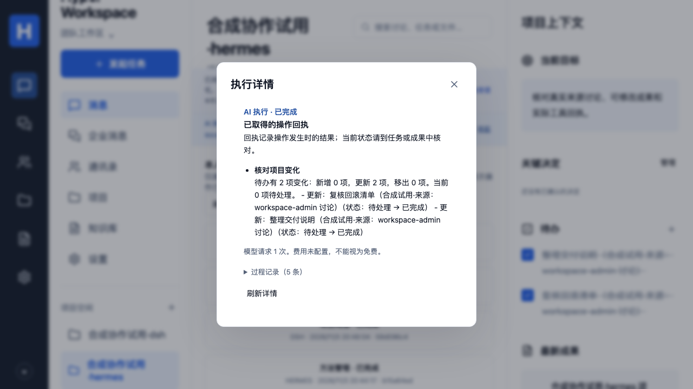

# 执行详情、回执与过程记录

2026-11-03。对应 P04/P07/P08、C05、A09/A10、E04/E08/E10，固定三层和首版范围不变。本批核对发现此前界面只有执行状态条，未提供文档所称的按需日志入口；本批补齐该入口，不能用旧文档表述证明先前已经完成。

## 员工使用

当前任务的状态条提供“查看执行详情”。项目的“执行记录”页可找回本人历史执行，刷新页面后仍可打开；列表按时间与编号排序，每页 20 条，可继续加载。列表只含本人的编号、引擎、工作流、状态和创建时间，不含任务提示、模型连接、来源文件名或执行结果。打开后重新核对当前员工对该 Run 和来源的访问权限，展示实际回执、保存版本、负责人、截止日期及已记录状态。回执反映操作发生时的结果，当前任务/成果仍须到对应业务对象核对；失败、停止和未知结果不被包装为自动回滚。

过程记录默认折叠，展开后展示按序的时间和业务事件，超过一页可继续加载。页面不会输出原始模型提示、推理过程、请求头、密钥或执行器文件。只在主动打开详情后读取记录，关闭或切换主体/项目后取消读取。详情打开期间对活动 Run 做有界串行状态检查；历史记录按本次读取展示，点击“刷新详情”可重新核对。权限失效、退出或来源暂时无法核验时，旧回执与记录清除，显示失败原因。

回执操作名称按当前 PlannedAction 工具契约完整列出，方法发布/撤回的 state 也显示为明确中文状态；旧的非契约标识不会替代实际 follow_up.check / method.manage。

终态结果和过程事件中的同一回执按一一对应合并；不会因为两次实际操作的结果完全相同而合并掉其中一次。未取得回执会明确说明“不代表一定没有发生操作”，不提供盲目重放入口。模型用量不完整和费用未配置保留为未知，演示执行明确标记未调用真实模型。

来源工作区的十秒刷新增加未完成请求保护。慢读取期间不继续叠加同类请求，完成后恢复检查；没有增加权限缓存、放宽来源检查或改变模型执行时限。

## API 与权限

- `GET /api/projects/:id/runs?before=<last-run-id>`：当前工作区/项目权限在读取前后复查，按主体和项目精确过滤，只返回上述五类元数据；游标也须属于同一主体/项目。每页最多 20 条；私人资料和完整内容在打开详情时另经 `getRun` 重新鉴权。
- `GET /api/runs/:id/history?after=0`：仅当前 Run 主体可读，继承 `getRun` 的工作区、当前来源及私人资料检查；通信管理继续使用已有公开元数据过滤。
- 每页最多 100 条，返回 `{events, after, hasMore}`；查询至多取 101 条判断下一页。游标须为非负安全整数，记录按 sequence 递增。
- 既有 `/api/runs/:id/events` 保持 SSE，JSON 历史使用独立端点；未把流式响应当 JSON 解析，也未改变原生执行器或工具协议。
- 初次详情入口没有数据库迁移。历史列表新增迁移 043，仅建立本人/会话/时间/编号的分页索引；没有修改业务数据或授权。旧应用可保留该索引继续运行，回退不删除 Run、版本或回执。严格恢复旧备份须使用对应源码/迁移版本，再正常升级，不能篡改备份清单。

## 已做验证与边界

慢请求回归在修正前复现刷新重叠，修正后通过。两项浏览器场景验证按需读取、折叠/展开、390px 手机布局和真实退出后清除旧回执；25 项数据库/执行规则检查通过，包含事件分页及其他员工/工作区不能读取；2 项回执合并单元检查保留失败 Run 中两次相同真实动作，避免漏报。既有 63 单元、类型和构建已通过；新代码完整 CI 另查其对应提交。首次界面检查中使用 SSE 路径读 JSON、开发 StrictMode 取消请求计数及时间戳定位问题均已修正，历史失败保留，不声称所有开发检查首轮通过。

下图为本机合成演示的真实浏览器截图，未调用模型，不冒充云端或公司验收：

[手机展开过程记录](images/run-details-mobile.png)

## E08 人类评阅材料

请分别检查两项，反馈仅记录这两项，不表示整体验收或公司采用：

1. 上述默认折叠和手机展开截图，是否符合“详细日志按需展开”。
2. 超时/停止后的说明是否清楚、能指导下一步核对。真实云端失败 Run `a42a16b7-1b45-4ac5-83f1-4e94d5f8e7bb` 在 180 秒达到限制，模型请求已有完整用量，动作记录为空；未将失败当作免费或自动重试。新界面对这类历史错误及新执行统一说明：

> 本次执行超过时间限制。请核对已完成操作和当前业务状态，再决定是否续做。

当没有取到回执时，另显示：

> 尚未取得已完成操作的回执，这不代表一定没有发生操作。请核对过程记录和当前业务对象，避免重复提交。

2026-11-03，用户对上述两项明确回复“两项都满足”。按需日志和失败说明的人类反馈已记录；连同此前纪要清晰度反馈，E08 的三项人类检查已齐。新代码完整 CI 仍独立核对，不把反馈扩展为公司采用或整体验收。

## 历史入口与实际回执补齐（2026-11-04）

真实云端只读页面复验发现：重新登录后没有当前 Run 状态条，旧详情入口因仅存 React 内存而无法找回既有记录；此次复验停止，未创建新业务 Run、调用模型或重放任务。这不是“后台没有记录”，也不能记成 UI 已通过。新增上述本人执行记录入口和源/私有权限重检，避免让员工靠重复执行找回回执。

实际工具契约核对另发现旧标签 project.follow_up / method.create 与当前 follow_up.check / method.write 不一致，已覆盖完整工具联合类型，并显示方法 state，后续漏工具名称会导致类型检查失败。新增协议 UI 断言核对跟进名称、静默说明和方法撤回状态；它验证前端实际回执形状，不冒称又执行了真实方法。首轮协议用例的历史 URL 误带必需问号，实际无查询参数，导致正确的 404 清理；修正测试路径后通过。

本地新增历史分页/主体/项目/游标隔离与撤权后拒绝，两项真 PG 用例已通过，所在工作区整文件 17 项通过；浏览器三项通过（21.7 秒，无重试），原详情用例增加刷新页面后从列表找回实际 fixture Run。第一次集成启动未配置独立 TEST_DATABASE_URL，被安全检查拒绝；配置现有专用测试库后通过，未对演示主库运行集成测试。类型/构建、65单元及完整255数据库检查已通过；整批新代码 CI 及更新后云端 UI 另行核对。

候选应用 `5b7d0bb` 已在私有阿里杭州更新并应用043，API/Worker健康；数据库、来源和向量容器未重建。165 个应用/SQL文件摘要、UID10001、更新前后无活动 Run 均核对。重新完成真实企业授权后，从“执行记录”打开原 Hermes 跟进 `b883814e-6ee2-4ca7-ba4f-9b32e0f0aa3f`，实际5条事件、桌面默认折叠、390px手机展开及无横向溢出通过；0次模型调用、0次业务写入。首次缺入口的失败仍保留，不通过重复任务制造状态条。

以下为更新后真实来源与历史回执的受控合成试用截图，已人工查看排版与敏感字段；不同于上面的本机 fixture 材料，也不代表公司已安装或新增人类质量签收：

[真实云端手机展开](images/cloud-run-history-mobile.png)

## 本批完整验证

实现 `5b7d0bb8490b45d2c69939b35d8ac6173d3d599f` 的 [CI 41696471949](https://github.com/MkaliezZ/hyper-workspace/actions/runs/41696471949) 三个任务全部成功，逐份完成日志核对453项：65单元、9 Python、8解析、255数据库、9原生、78 UI、18真实来源、7容器、4 IP TLS/代理；78 UI无重试，来源18项用时13.5分钟。真实来源新增本人历史元数据与来源撤权404，容器包括043迁移及配套产品恢复。协议模型与真实供应商结果仍分别记录。 先前“新批待核对”描述保留开发时序，以本节为最终技术结果。公司实际安装/容量/签收仍待目标机，不由这些样例替代。
