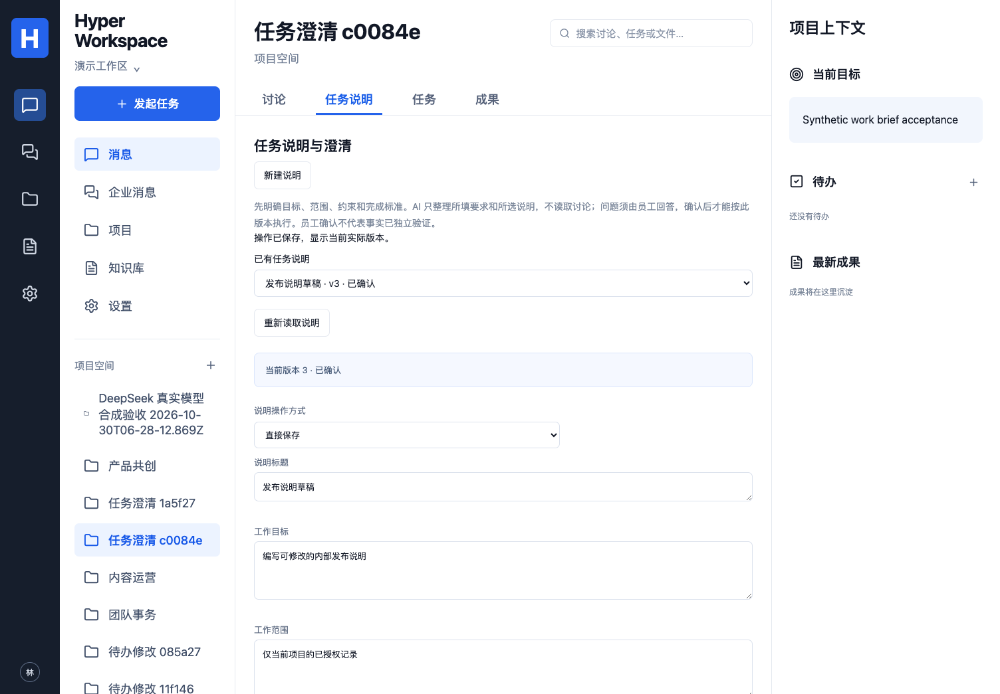

# 任务说明、必要澄清与确认版本

映射：P02/P04/P05/P07/P08；C01/C02/C04/C05/C07；A02/A06/A09/A10；E01/E02/E04/E07/E08/E09/E10 子集。默认 DSH、兼容 Hermes、业务数据与权限归产品核心的固定基线不变。

## 使用流程

项目的“任务说明”页保存目标、范围、约束、完成标准和待澄清问题。说明及答案对**当前可访问项目的成员**可见；仅创建者或当前管理员可维护、回答、确认和重新打开。员工角色由服务端回读，模型和旧会话角色不能授予权限。

可以人工编写，或选择执行器/模型让 AI 整理所填要求和所选说明。此入口不自动读取项目讨论或其他文件。AI 可以提出问题、保留缺口，不能自行填写员工答案或确认决定；员工选择明确答案/确认方案后，可直接保存或由 AI 按相同方案代保存。两者共用一个服务、版本规则和实际回执。

状态为“待补充澄清 / 待确认 / 已确认”。范围、完成标准为空或任何问题未回答时，服务端拒绝确认。问题文本列表不变时保留原问题 ID 和员工回答；列表变化则创建新问题并清空旧回答。任何修改或回答都会撤销原确认，员工必须检查新版本。

“已确认”只表示有权员工同意按该说明开展工作，不表示事实、质量或实际工作完成已独立验收。AI 生成说明的 Run 成功只证明说明保存，不代表说明要求的工作已经执行。

## 绑定执行与中断

确认后通过“按此说明发起任务”引用确切 ID/版本，可用于讨论转纪要、项目周报和成果修订。既有直接任务入口保留；此版本不宣称已自动识别所有自由文本歧义或将全部执行强制改为说明优先。

准入、上下文准备、每次模型请求、业务动作及最终发布检查当前项目权限和确认版本。产品将说明与员工回答作为明确标记的任务数据交给模型，不将其升级为 Policy 或独立验证事实。成果来源和 Run 上下文均保留说明版本引用。

说明被修改或重新打开后，旧引用不能发起新执行。已有 Run 的后续业务动作会被当前版本检查阻止；动作事务中的说明锁与版本核验防止预检查后的竞争。已经保存的业务动作不假装回滚；发生部分动作后失效会保留回执并进入待核对。模型调用费用可能已产生，不因停止而退款。

澄清等待属于产品说明对象，可跨浏览器/执行器继续。保存答案、确认和后续业务执行分别有回执；没有将原生进程停在私有检查点，也不声称实现全部运行中原生交互请求的恢复或热迁移。

## 接口、版本与权限

- `GET /api/projects/:id/work-briefs`：当前项目最近 100 条摘要。
- `GET /api/projects/:id/work-briefs/:briefId`：当前版本及最近 20 个完整版本；完整历史仍保存在 PostgreSQL。
- `POST /api/projects/:id/work-briefs`：`{plan,draft?,idempotencyKey}`。create/revise 必须有内容；answer/confirm/reopen 不得夹带内容。
- AI：`RunInput.workflow=manage_brief`、明确 `briefPlan`。create/revise 只接受一个 `brief.write` 严格内容对象；其他操作只接受一个 `brief.manage {}`，答案/确认来自主机保存的员工方案。
- 业务执行：`RunInput.briefRef={id,version}`。主体、工作区、项目及目标权限由后端核验，不接受模型选择。

标题最多 200 字符，目标/范围/约束/完成标准各 4000 字符，最多 10 个不重复问题、每题 600 字符，员工回答每题 4000 字符。发给模型的完整输入仍受原有上下文、输出、时间及费用规则限制。说明输入不是凭据入口。

版本包含完整字段、问题/答案、状态、确认人、基础 Policy 版本、人工/AI 通道、修改主体及来源 Run。版本 CAS、幂等记录、内容与审计在同一事务保存；并发冲突拒绝覆盖，审计失败回滚，失权不回放旧回执。列表/详情前后核验项目来源；拒绝读取后页面清理正文、答案、缓存列表，迟到响应不能恢复旧内容。

## 部署与回退

迁移 `021_work_briefs.sql` 增加说明、版本、动作审计表及 Run 的计划/引用列；沿用迁移角色与 cw\_ 表运行权限授权，无新服务或依赖。企业资料继续留在现有 PostgreSQL，不依赖 DSH/Hermes 私有数据库；没有自动将说明变成向量索引。

回退前停止新派发，排空/停止并核对 manage_brief 与所有带 briefRef 的排队/运行任务，保留说明版本、动作和回执。旧代码不认识新计划和版本闸门，不能让旧 Worker 继续执行这些任务。先在备份环境演练，不能通过删除说明或 Run 来假装撤销已发生动作。

## 验证与边界

6 个新增真实 PostgreSQL 场景覆盖确认前缺口、员工答案、版本/CAS/幂等、跨项目引用、当前维护权限、AI 参数伪造、动作事务前重开及审计回滚；完整 124 数据库、25 单元/配置及类型/构建本机通过。新增原生场景验证 DSH 建说明 → 员工回答 → Hermes 续改/确认 → DSH 按同一对象执行，最后重开阻止下一次模型请求。使用合成协议模型，非真实模型质量结论。

浏览器流程：项目 → 说明草稿 → 回答 → 确认 → 实际 Worker 绑定执行 → AI 修改且保留人工草稿 → 手机操作 → 拒绝读取及迟到响应清理。定向场景通过，桌面 1504×1045/手机 390×844 截图已查看，蓝白黑、无横向溢出；检查 URL/标题、非空内容、无框架 overlay、控制台及实际对象回读。Browser plugin not available，使用项目 Playwright Chromium；Safari/Firefox 未测。

首轮 UI 在通用“执行服务”标签定位超时，改用可访问 combobox 名称后通过；未将首轮失败计为通过，trace 在被忽略的本机受限目录保留。完整界面/原生回归与最终 CI 结果见 [实现记录](IMPLEMENTATION.md)。

[手机任务说明](images/work-brief-mobile.png)。全部截图为明确合成资料。尚缺通用自动歧义路由、跨任务的完整澄清交互、真实员工理解质量量规和完整企业验收，不把该子集标记为 C01 或 E01–E10 全量完成。
